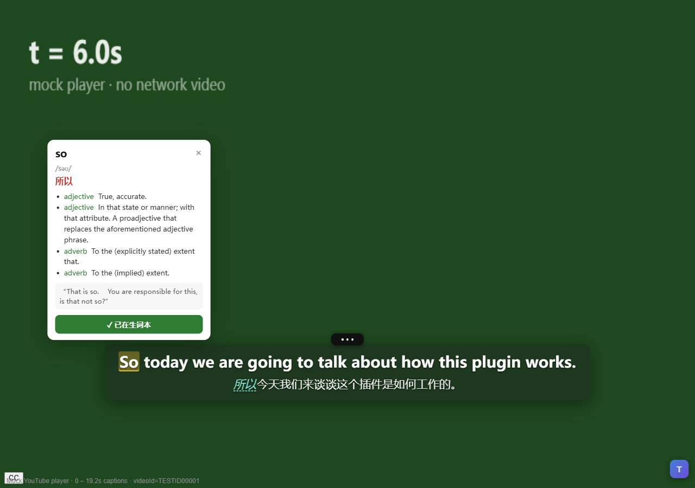

# Trace 字幕翻译

看 YouTube 英文视频时，在画面上显示**中英双语字幕**；鼠标点任意一个单词，弹出中文释义，
一键存进生词本；存过的词**在任何视频里都会自动高亮**，方便复习。

免费、开源、不用注册登录，字幕和生词本都保存在你自己的电脑上。



> 这个项目起因于逆向分析付费插件 **Trancy**（v7.9.4），搞清它怎么拿到 YouTube 字幕、
> 怎么做双语渲染，然后从零写了一个功能对等的替代品。逆向结论在本文后半部分，
> 只想用的话直接跳到 [三、安装与使用](#三安装与使用)。

## 它能做什么

| | |
|---|---|
| **双语字幕** | 原文 + 中文上下两行，跟着视频自动推进；长句在逗号、句号处自动断开，不会糊成一大坨 |
| **点词查义** | 点字幕里任何英文单词，弹出音标、中文释义、这个词在本句里的意思；英文原文折叠收起，不挡视线 |
| **卡片可调** | 详细程度三档（简洁 / 标准 / 详细），四套配色样式（白卡 / 纸质 / 墨黑 / 极光），14 种词性各有专属颜色 |
| **划短语** | 鼠标拖选连续几个词（如 `dive in`），松手就查整段短语的意思，而不是逐词硬拼 |
| **生词本** | 一键收藏单词或短语；**跨视频高亮**——今天存的词，明天看别的视频照样亮起来 |
| **背单词模式** | 收藏过的词再出现时，把译文里对应的中文遮住（模糊），鼠标移上去才看清；盯够久或点开卡片算一次复习，卡片上还能直接标「已经记住」 |
| **词态一眼分色** | 已记住的词是淡绿，没记住或还在记的是红色，扫一眼就知道哪些该重点看 |
| **单复数同源** | 收藏了 `beverage`，字幕里出现 `beverages` 也会高亮，点进去是同一个词条 |
| **不丢数据** | 生词本可写成本机文件；卸载重装插件后能恢复，学习进度（复习次数、是否已记住）也保留 |
| **不碍事** | 字幕贴视频画面而不是浏览器窗口，全屏自动等比放大；压住 YouTube 自己的设置菜单时自动淡出；视频滚出视野就隐藏 |
| **可换翻译引擎** | 默认用 Google 免费接口（快、零成本）；也可接自己的大模型（OpenAI 兼容 API），习语和上下文翻得更准 |

## 三分钟装好

1. 下载本仓库（右上角 Code → Download ZIP，或 `git clone`）
2. Chrome 地址栏输入 `chrome://extensions/`，打开右上角「开发者模式」
3. 点「加载已解压的扩展程序」，选择仓库里的 **`trace-subtitles`** 文件夹
4. 打开任意 YouTube 视频，字幕会自动出现

不需要注册账号，不需要填任何 API Key。想换大模型引擎再去设置里填。

---

# 附：Trancy 逆向分析

以下是「它为什么能工作」的技术记录，供想自己改造或复刻同类插件的人参考。
只想用插件的话，上面的内容就够了。

## 一、Trancy 是怎么工作的

被分析的目标：`%LOCALAPPDATA%\Google\Chrome\User Data\Default\Extensions\mjdbhokoopacimoekfgkcoogikbfgngb\7.9.4_0`
（扩展 id `mjdbhokoopacimoekfgkcoogikbfgngb`，Manifest V3，核心产物是 webpack 打包后的
`assets/edvideo-main.js`（2.3 MB）、`assets/background.js`（312 KB）、`assets/edvideo.css`（290 KB））。

### 1. 三层结构：content script 只是"引信"

`manifest.json` 里针对视频站点（YouTube / Netflix / HBO Max / Disney+ / Prime Video / TED /
Coursera / Udemy / edX / Bilibili / Vimeo）注入的 content script 是 `assets/edvideo-onload.js`，
只有 **2.4 KB**，它只做三件事：

1. 转发快捷键：`window.postMessage({to:'background', from:'content', eventName:'hotkey', ...})`；
2. 建一个 Trusted Types policy（`trancy-inject-policy`），绕过站点 CSP；
3. **把真正的业务代码注入页面主世界**：

```js
const s = document.createElement('script');
s.src = chrome.runtime.getURL('assets/edvideo-main.js');
s.type = 'module';
document.documentElement.prepend(s);   // 还有 romanize-main.js、ld-main.js
```

这一步是关键设计。MV3 的 content script 跑在**隔离世界（isolated world）**，看不到页面的
JavaScript 变量；而字幕数据藏在页面的 `window.ytInitialPlayerResponse` 里，要 hook
`JSON.parse` / `XMLHttpRequest` 也必须和页面同世界。所以 Trancy 用「隔离世界做引信 + 主世界跑业务」
的桥接模式，靠 `postMessage` 通信。

> 我在 `tools/probe-ext2/` 做过对照实验验证这一点：`document.getElementById('movie_player')`
> 在 MAIN world 里 `typeof getPlayerResponse === 'function'`，在隔离世界拿到的是空壳
> （`hasPlayer: false`）。这解释了为什么 Trancy 必须走注入路线。

### 2. 字幕从哪来：优先读播放器对象，其次 hook 网络

**YouTube**（`edvideo-main.js` 里的 `getYoutubeTracks()`）：

```js
const pr = player.getPlayerResponse();
pr.captions.playerCaptionsTracklistRenderer.captionTracks
```

拿到的每条轨道形如 `{ baseUrl, languageCode, kind, vssId, name }`。判定逻辑：

- `kind === 'asr'` → 自动生成字幕（ASR），其 `languageCode` 同时作为 `audioLanguage`；
- 有非 `asr` 且无 `trackName` 的轨道 → 判定存在"人工字幕"（`hasbuilinCaption`）。

拿到 `baseUrl` 后拼 `&fmt=json3`（或 `srv3` / `vtt` / `ttml`）拉字幕正文。内置支持
**json3、vtt、ttml、sub** 四种格式。

> **2024 之后的重要变化：timedtext 需要 `pot` 签名。**
> 直接请求 `baseUrl&fmt=json3` 现在会返回 **HTTP 200 + 空 body**（0 字节）。
> 这不是 URL 拼错了，而是 YouTube 要求请求带 `pot`（proof-of-origin token），
> 而 pot 只在**页面自己发出的请求**里才有。
>
> 复刻时踩过这个坑，最终解法是：**hook 页面的 fetch / XMLHttpRequest，截获
> `/api/timedtext` 的响应正文**。页面为了显示原生 CC 必然自己发这个请求，钩子顺手
> 拿到带 pot 的完整字幕——这是唯一稳定的路径。Trancy 的 2.3MB 主世界脚本同样在
> hook 网络层，原因就在这里。

**其它平台各有各的脏活**（这是这类插件的护城河）：

| 平台 | 抓取方式 |
|---|---|
| Netflix | hook `JSON.parse`，从响应里取 `result.timedtexttracks` + `ttDownloadables` |
| HBO Max | 从 `${n}.vtt` 逐段自增拼 URL，直到 404，再 parseVtt |
| Bilibili | hook XHR，匹配 URL 含 `subtitle/` 的响应，映射 `{start: from*1000, end: to*1000, text: content}` |
| Prime Video | hook `GetVodPlaybackResources`，取 `timedTextUrls` / `subtitleUrls` |
| DeepLearning.ai | hook `.vtt` 的 XHR |

另外它还从 `streamingData.adaptiveFormats` 里挑 `mimeType` 含 `audio` 的流
（字段 `whispering` / `whisperID` / `useWhisper`）——**没有字幕时上传给 Whisper 做语音转写**。

### 3. 核心难点：智能分句（sentencizer）

YouTube 的自动字幕是**碎片**，按呼吸停顿切，一句话被切成三四段，还带大小写和标点错误：

```
So today we are going to talk
about how this plugin works.
The first step is to capture
the subtitle tracks from the player,
```

直接逐条翻译，译文必然断裂、代词指代全丢。Trancy 的做法是先把碎片**重组成完整句子**再翻译：

- `POST https://api.trancy.org/1/sents`（NLP 分句服务，响应缓存 ttl 15s）

这是它翻译质量明显优于"逐条翻"的根本原因，也是整个流水线里最难复刻的一环。
我的复刻版用本地启发式算法（见下文）实现了同一目标。

### 4. 翻译与词典后端

统一入口 `Rs = { API_ENDPOINT: 'https://api.trancy.org' }`：

```
POST /1/translation          { text, from, to }        ← 翻译主接口
POST /1/sents                                          ← 智能分句
POST /2/sentences/grammar                              ← 语法解析（有 stream 版）
GET  /2/phrases  /1/word/definition  /4/words
GET  /1/words/{w}/sentences  /1/tts/voices  /1/voice   ← TTS 返回 mp3 Blob
POST /1/words  /1/word-contexts                        ← 生词本 + 语境
POST /evaluations  (FormData 上传录音)                  ← 跟读发音评测
```

请求头 `x-trancy-version` / `x-trancy-et` / `x-trancy-app` / `x-locale`，
登录后带 `Authorization: Bearer <token>`。

`background.js` 里还内置了**第三方引擎的直连代理**，说明它允许用户自备 key：

- DeepL：`api.deepl.com/v2/translate`、`api-free.deepl.com`
- 微软 Edge：`edge.microsoft.com/translate/auth` → `api-edge.cognitive.microsofttranslator.com/translate?api-version=3.0`
- LLM 系：OpenAI、DeepSeek（`api.deepseek.com/chat/completions`）、xAI grok、Anthropic
  `/v1/messages`、Gemini `generativelanguage.googleapis.com/v1beta/models/`、SiliconFlow、
  OpenRouter、火山方舟、阿里 DashScope、百度千帆、腾讯混元、智谱 `open.bigmodel.cn/api/paas/v4/chat/completions`

### 5. 渲染层

CSS 类名体系（`edvideo.css`）暴露了它的结构：

```
.trancy-container > .trancy-wrapper
  .trancy-caption-container
    .trancy-subtitle-container
      .trancy-primary-subtitle      ← 原文
      .trancy-secondary-subtitle    ← 译文
  .trancy-controller / .trancy-page-setting / .trancy-setting-pannel
  .trancy-word-details / .rd-dict-definition
```

`primary = 原文`、`secondary = 译文`（内部变量命名是 `target` 语言 = 字幕语言、
`native` 语言 = 翻译目标语言）。三种模式：`reader`（阅读模式）、`cinema`（影院沉浸）、
`complex`（复杂布局）。字幕随 `video.currentTime` 高亮推进，单词可点出词典卡。

**入口与设置面板**（对照真实截图确认）：Trancy 在播放器控制栏最右端（紧邻全屏按钮）
放了一个紫色圆角方块图标，点击弹出**页内深色侧栏面板**，而不是浏览器工具栏的 popup。
面板结构（自上而下）：

```
Trancy 字幕  ⓘ                      [开关]
AI 字幕  ⓘ
主字幕        English
翻译字幕      中文
AI 总结
收藏视频
翻译引擎      Google
字幕显示      双语字幕
字幕样式      ⋮      ← 点开才是字号/颜色/背景等细项
键盘控制
更多功能
[学习模式 ⓘ] [旧版本]
```

这个设计的用意：用户在看视频时不该被迫离开画面去点工具栏图标 ——
入口贴在播放器上、面板浮在画面上，调完即走。复刻版按这个思路实现（见下文
「播放器右下角悬浮按钮」与「页内设置面板」）。

### 6. 完整数据流

```
页面加载
  └─ content script (隔离世界) 注入 edvideo-main.js → 主世界
       └─ 读 player.getPlayerResponse().captions.captionTracks
            └─ fetch baseUrl&fmt=json3  → 解析成 cue 列表
                 └─ POST /1/sents  智能分句（碎片 → 完整句子）
                      └─ POST /1/translation  批量翻译（+ IndexedDB 缓存）
                           └─ 渲染 .trancy-primary/secondary-subtitle
                                └─ rAF 跟随 currentTime 切换当前句
                                     └─ 点词 → /1/word/definition → /1/words 入生词本
```

---

## 二、复刻产物：Trace 字幕翻译

`trace-subtitles/` 是一个**零依赖、零 API key、可直接加载**的 MV3 扩展，
只保留 Trancy 最核心的 YouTube 双语字幕 + 查词 + 生词本（按需求收窄范围）。

### 文件

| 文件 | 职责 |
|---|---|
| `manifest.json` | MV3 声明；两组 content_scripts（主世界 + 隔离世界）；host 权限只开 4 个域 |
| `main-world.js` | 跑在页面主世界：读 `getPlayerResponse()` / `getOption('captions','tracklist')`，`fetch` 字幕正文，`postMessage` 桥接 |
| `subtitles.js` | 纯函数库：`parse()`（json3/srv3）、`segment()`（智能分句）、`splitLong()`（超长句二次切分）、`hash()`、`findByTime()`、`wordForms()`（词形归一化） |
| `content.js` | 隔离世界主控：轨道选择、批量翻译、双层字幕渲染（含 `fitToFrame()` 自适应缩小）、rAF 推进、点词、查词弹窗、生词高亮（含词形变化）、悬浮按钮与页内面板 |
| `bg.js` | Service Worker：设置、翻译（Google + MyMemory + 大模型降级）、词典、IndexedDB 缓存与生词本、译文词定位（`findWordHits` / 三路旁路探针 / `DIFF_MAX_ZH`）、**备份/恢复落盘** |
| `overlay.css` | 字幕覆盖层 + 查词弹窗 + 悬浮按钮 + 页内设置面板样式 |
| `theme.css` | **共享设计系统**（墨黑分层底 + 暖金强调 + 字体/圆角/按钮/卡片原子类），被 popup 与词库页共用 |
| `popup.html` / `popup.js` | 工具栏弹窗：设置 + 生词本精简列表 |
| `wordbook.html` / `wordbook.js` | **词库看板**（独立页面）：KPI、学习状态环、每日新增柱状图、筛选/搜索/抽屉/复习/删除、**备份与恢复**（含自选文件夹） |
| `icons/` | 4 个尺寸图标（纯 Node zlib 手写 PNG 生成） |

### 三个技术要点

**① 主世界桥接**（`main-world.js` ↔ `content.js`）

主世界监听 `__TRACE_REQ__`，回 `__TRACE_RES__`：

```js
window.postMessage({ type:'__TRACE_REQ__', id, action:'tracks' | 'captions' | 'dom-caption' | 'ping', payload }, location.origin);
```

轨道读取三路径兜底：

```js
const pr = getPlayer().getPlayerResponse();          // 主路径
pr?.captions?.playerCaptionsTracklistRenderer?.captionTracks
getPlayer().getOption('captions', 'tracklist');      // 兜底 1
window.ytInitialPlayerResponse.captions…              // 兜底 2
```

**字幕正文获取的五级降级链**（`main-world.js` 的 `ensureCaptions()`）：

| 顺序 | 路径 | 说明 |
|---|---|---|
| 1 | `hook` | 网络钩子已截获页面自己发的、**带 pot** 的 timedtext 响应 —— 最可靠 |
| 2 | `transcript-api` | `/youtubei/v1/get_transcript` + 从 `ytInitialData` / `/v1/next` 挖到的 `params` |
| 3 | `direct` | 直接请求 `baseUrl&fmt=json3`（老视频可用，新视频常返回空 body） |
| 4 | `hook-forced` | 主动 `setOption` / `loadModule` / 点 CC 按钮，逼页面去请求，钩子接住 |
| 5 | `transcript-panel` | 点开 YouTube「显示字幕文稿」侧栏，直接读已渲染的 DOM 段 |

全部失败时，内容脚本还有最后一道 **DOM 兜底**：每 400ms 读一次 `.ytp-caption-segment`，
对当前这一句做实时翻译（带内存缓存）。并每 ~5 秒尝试"升级"回完整模式。

**② 智能分句**（`subtitles.js` 的 `segment()`）

不依赖任何 NLP 服务，用启发式把碎片拼成句子：

- 收句条件：句末标点 `SENT_END = /[.!?。！？…]["'”’)）\]]*\s*$/`
- **句中句号也断句**：`SENT_MID = /[.!?。！？…]["'”’)）\]]*\s+/g`（见 bug 19）。
  cue 里塞两句是 ASR 常态，只看结尾等于放弃那个句号，两句会被连成一行超长英文
- 边界条件：与上一片的时间间隔 `gap > 2.0s` 也强制断开
- 超长保护：`maxLen = 120` 字符，超出交给 `splitLong()` 二次切分（见下）
- 处理 YouTube 自动字幕的典型脏数据：碎片无标点、首字母小写、重复滚动行

实测把测试夹具的 **13 行碎片 → 6 个句子**，最长 111 字符，译文连贯。

分句是**两级**的：`splitAtSentEnd()` 先按句中句号切成真句子，每句仍超过 `maxLen`
时再交给 `splitLong()` 按逗号/空格切。两级都按字符数比例分摊时间轴，否则
`findByTime()` 只命中第一段，后面几段永远显示不出来。

**超长句二次切分（`splitLong()`）**

`maxLen` 从 180 收到 120 是踩了实际观感之后的决定：180 时字幕框最宽可到
1180px，一句 130 字符的英文能撑满两行、配上中文三行，整个框能占到画面高度的
40%（截图里那句 Emirates 头等舱的字幕就是这种情况）。收到 120 后，多数长句会在
逗号处断成两段，每段一行。

`splitLong()` 不是"按 120 硬切"，因为硬切会把词切两半、也会切出
`not each fragment.` 这种 18 字符的孤儿片段，单独闪一下反而更打断阅读。它的做法：

1. 先算需要几段 `n = ceil(len / maxLen)`，再按 `n` 均分得到 `target`；
2. 在 `target` 附近（±35%）找断点，**优先断在逗号/分号后面** —— 断在标点处的语义完整性最好；
3. 范围内没有标点就找**最近**的空格（不是最靠后的空格 —— 取最靠后会切出超过
   `maxLen` 的长段，等于白拆。第一版就犯了这个错，实测切出 134 字符的段）；
4. 整段没空格（极端 ASR 产物）才硬切，否则会死循环；
5. 尾巴短于 26 字符就并回上一段，宁可上一段略长，也不要单独闪一个短片段。

切段后时间轴按字符数比例分配，否则 `findByTime()` 只会命中第一段，后面几段永远
显示不出来。

**自适应缩小（`fitToFrame()`）**

拆分不是万能的：用户可以把字号调到 48px，全屏时还有 `--trace-vscale` 放大。
所以再加一道兜底 —— 量出字幕框的自然高度，超过画面高度 55% 就按超出比例缩小
`--trace-fit`（CSS 里与 `--trace-font-scale`、`--trace-vscale` 相乘），下限 0.62。
再小就不可读了，那时宁可让框超出也不缩成蚂蚁字。

实测三组（1440×900 画面、190 字符长句）：

| 场景 | 框高 | 占画面 | `--trace-fit` |
|---|---|---|---|
| 修复前（`maxLen=180`，无切分） | 171px | 19.0% | — |
| 修复后（`maxLen=120` + 切分） | 103px | 11.4% | 1（无需缩小） |
| 修复后 + 字号 48px/缩放 1.6 | 498px | 55.3% | 0.936（兜底生效） |

关键数字：修复后长句与短句的框高**都是 103px**，即框高不再随句长变化。

**③ 翻译引擎：Google 免费端点的正确用法**

这是逆向过程中实测出的关键细节（`tools/probe-sw-api.js` 验证）：

```
POST https://translate.googleapis.com/translate_a/t?client=gtx&sl=en&tl=zh-CN&dt=t
Content-Type: application/x-www-form-urlencoded
body: q=句子1&q=句子2&q=句子3
→ ["译文1","译文2","译文3"]     ← 按 q 顺序返回的 JSON 数组
```

- **必须 POST**；同样的参数用 GET 会 **400**；
- 一次可传多条，天然适合批量字幕翻译（本实现每批 40 条）；
- 失败降级到 MyMemory：`https://api.mymemory.translated.net/get?q=...&langpair=en|zh-CN`。

**缓存**：翻译结果与词典结果都写进 IndexedDB（`trace-subs` v1，`translations` + `words` 两个
store），同一个视频二次打开不再请求网络。

**④ 生词本状态与跨视频高亮**
生词本存在 IndexedDB 的 `words` store（`keyPath: 'word'`，键为小写形式）。围绕它有三条链路：

```
加入生词本 → word:add → 写 IndexedDB → broadcastWordsChanged()
                                        └─ chrome.tabs.sendMessage(所有 YouTube 标签页, 'words:changed')
                                             └─ content.js: loadWordSet() → 拉 word:keys → 更新 Set → 重渲染

内容脚本启动 → loadWordSet() 拉一次全量词表（只传小写单词数组，不传释义）
渲染字幕 → renderWords() 逐词查 Set，命中就加 trace-saved 类

点击单词 → 并行两件事：查词典 / 问 word:has 是否已收藏
          → 已收藏则按钮渲染成「✓ 已在生词本」（data-act="remove"），点一下可移除
```

几个设计取舍：

- **只传单词集合**：`word:keys` 返回 `['so','the',...]` 而不是完整记录。几千个词也才几十 KB，
  比每次传释义/语境轻得多。
- **立即本地生效**：点「加入」成功后先把词塞进内存 `Set` 并重渲染，不依赖广播回来 —— 用户
  看到高亮是**瞬间**的。广播只负责同步**其它已打开的标签页**。
- **以数据库为准**：打开弹窗时并行问一次 `word:has`，用 IndexedDB 的真实结果校正内存 Set，
  避免多标签页并发操作导致的内存与磁盘不一致。
- **广播不需要 `tabs` 权限**：`host_permissions` 已含 `youtube.com`，`chrome.tabs.query({url})`
  可以直接按 URL 过滤；申请 `tabs` 权限反而会触发"读取浏览记录"的安装警告。

**⑤ 译文里对应词也高亮：三路旁路探针**

难点：英文 `word` 在中文里可能译成"单词"、"字"、"词"，**没法靠词典反查位置**。

第一版的做法是「在词两侧插哨兵，让翻译引擎自己告诉我位置」。这个方案后来被推翻了 ——
原因见 [bug 18](#bug-18插哨兵会改坏译文把-iron-pick-译成熨斗挑选)。现在的做法是
**主译文一个字符都不动**，另外并行发几个"探针"去问 Google，再拿探针的答案回主译文里定位：

```
主译文：  好吧，至少我想现在是制作铁镐的好时机。        ← 干净请求，没有任何标记
                                        ↑
探针 A（替换）：好吧，至少我想现在是选 zqxv 的好时机。 → 前后缀差分 → 「现在是制作铁镐」
探针 B（单词）：pick                     → 「挑选」   ← 在不在主译文里？不在，弃
探针 C（窗口）：iron pick                → 「铁镐」   ← 在！而且比差分短 → 选它
高亮：    └── 铁镐 ──┘  ← 2 个字，精确
```

三种探针各有所长，所以**同批全发**（Google 一次可带几十个 q，实测 80 个也正常，
多问几个只增加一点字节数，不增加往返次数）：

| 探针 | 做法 | 强项 | 弱项 |
|---|---|---|---|
| 替换 | 把目标词换成等长无意义串，再和主译文做前后缀差分 | 覆盖面最广（25/28 句有产出） | 差分区域常吞掉半句，宽度有噪声 |
| 单词 | 单独翻目标词 | 永远有答案 | 丢语境：`pick`→「挑选」而本句是「铁镐」 |
| 窗口 | 左邻词+目标词、目标词+右邻词、左+目标+右，三种形状 | 21 句实测左邻形状命中 9 句，最准 | 跨句时会带上下一句开头，必须掐掉 |

最后按三条规则挑**最短且落在主译文里**的那个（`pickCandidate`）：候选必须含中文、
必须**字面出现在主译文里**（否则位置会框错）、必须**严格短于差分区间**。
三者都不满足就这一次不亮 —— 宁可不亮，也不亮错位置。

几条踩过才知道要加的约束：

- **窗口只能由字母词组成、用单空格连接，且跨句不拼**。最初的实现是「左右各 r 个
  token」，token 里同时含空格与标点，`halves` 左右各 1 个 token 得到的是 `"halves."`
  —— 不含空格，被 `includes(' ')` 这道门整条丢弃。把 r 调大能让窗口含空格，但
  `"two halves. Cream"` 会把**下一句开头**卷进来，译成「两半。奶油」，不是主译文的
  字面子串，照样落空。必须按**词**取窗口，且两个词之间若跨句子边界就放弃这个窗口。
- **左右两侧分开给，不能只给一边**。11 句实测的命中率（翻出的中文是否字面出现在
  主译文里）：左邻+词 `iron pick` 9/11、词单独 7/11、词+右邻 1/8、左+词+右 1/8。
  右侧单独用几乎没用（`cloud these`→「云这些」），但它能救句子开头的词（没有左邻），
  所以三个形状都发。左邻 + 单词的并集已达 10/11。
- **差分要有绝对宽度上限 `DIFF_MAX_ZH = 7`**。相对闸门「≤ 原译 50%」在长句会放行过宽
  区间：用户实报 33 字的句子里 `vintage` 差出 **11 字「这些老式的东西也在那里」**，
  半个句子被点亮。30 句语料扫描下来，上限取 7 时 precision 0.89 / coverage 0.63，
  而 9/8/7 三档结果完全相同，所以取最紧的 7 留余量。**精确候选不受这条限制** ——
  它们本身短、而且必须字面出现在译文里，不存在这个问题。
- **`al7` 缓存键版本号**：对齐结果按「引擎 + 译文语言 + 原文 + 待高亮词集合」缓存。
  每次改定位算法都要提版本号，否则旧缓存里那些宽 span / 空 span 会被原样读回来
  （`al5`→`al6` 是因为加了宽度上限，`al6`→`al7` 是因为换了窗口形状）。
- **退化路径**：所有探针都失败时退回纯译文，中文不高亮但至少能读，不会显示乱码。


### 过程中修掉的二十四个真实 bug（值得记录）

> 这些条目按**发生时间**排列，保留当时的方案与判断。其中 bug 7–12、16 涉及「哨兵对齐」，
> 而那套方案后来被 **bug 22** 整体推翻（它会把译文改坏），现在读那些条目时把
> 「哨兵」理解为「当时的定位手段」即可 —— 现象与教训仍然成立，实现已不存在。

**bug 1：跨消息传函数。** `content.js` 曾把 `hash: S.hash` 放进 `chrome.runtime.sendMessage`，
而消息经过结构化克隆会丢掉函数，SW 侧抛 `TypeError: hashFn is not a function`。
修复：哈希函数在 SW 内部定义（`hashStr`），消息里只传数据。

**bug 2：公开词典 API 会永久挂起。** `api.dictionaryapi.dev` 对 `So` 这类词**不返回也不报错**，
`fetch` 永远 pending，界面卡在"查询中…"。修复：

```js
async function fetchT(url, init = {}, ms = 8000) {
  const ctl = new AbortController();
  const timer = setTimeout(() => ctl.abort(), ms);
  try { return await fetch(url, { ...init, signal: ctl.signal }); }
  finally { clearTimeout(timer); }
}
```

并把 `lookupWord` 改成**词典与中文释义并行、各自独立降级**：

```js
await Promise.all([dictTask /* 3.5s 超时，失败静默 */, zhTask /* Google 中文释义 */]);
```

`So` 的查词耗时从"永不返回"变成 3.9s 内必返回。

**bug 3：新版 YouTube 的 timedtext 需要 pot 签名（最隐蔽的一个）。**

在真实 YouTube 上，扩展日志显示 `empty timedtext` —— 轨道读到了、URL 也拼对了，
但 `/api/timedtext?...&fmt=json3` 返回 **200 + 0 字节**。排查过程：

1. 换 `fmt=srv3` / 不带 `fmt` → 同样空；
2. 换 `credentials:'include'` → 同样空；
3. 对照实验：让页面自己发同一个 URL（点开 CC）→ 有内容；
4. 结论：差别在 **`pot` 参数**，它由页面 JS 在运行时生成，只有页面自己发的请求才带。

修复就是 `main-world.js` 里的网络钩子 —— hook `window.fetch` 与
`XMLHttpRequest.prototype.send`，对 `/api/timedtext` 的响应 `clone().text()` 存起来。
为避免切换视频串台，捕获记录里带 `v=` 视频 ID，读取时按当前视频过滤。

为此新增了专门的回归测试 `tools/test-pot.js`：把站点伪造成 pot 模式
（不带 pot → 空 body，带 pot → 正常 json3），断言字幕必须从 `hook` 路径拿到。

**bug 4：翻译竞态 —— 选 Google 时"只有英文没有译文"。**

现象：选 Google 引擎时字幕只有原文，切到 MyMemory 就正常。第一反应是"Google 被限流/被封"，
于是写了一轮压力测试把它排除掉：

- 800 句 × 25 句/批共 32 批 → 全部 200、`empty:0`；
- 连续 12 批 × 40 条（模拟真实视频）→ 12 批全 200，耗时 332–874ms，`empty:0`；
- 各种特殊字符（`& # % " < >`）、超长句、含换行 → 全部正常。

也就是说**引擎侧完全没问题**，问题在我们的代码。真正的根因有两个，叠在一起：

1. **并发竞态（主因）**：`loadSubtitles` 会被 `init` 和 `yt-page-data-updated` 触发两次。
   第二次重建 `state.sentences` 后调 `translateAll()`，而旧版 `translateAll` 开头是
   `if (state.translating) return;` —— 于是第二轮直接退出，但它已经把
   `state.sentences` 换成了**全新的、没有 `zh` 字段的对象**。第一轮的译文写进的是
   旧对象，新对象永远空白 → 界面只有原文。
   修复：用**代际令牌** `translateGen` 代替布尔锁。

   ```js
   let translateGen = 0;
   async function translateAll() {
     const gen = ++translateGen;               // 每次启动拿新代号
     for (const chunk of batches) {
       if (gen !== translateGen) return;       // 旧轮次自觉退出
       await translateChunk(chunk, …, gen);
     }
     if (gen === translateGen) state.translating = false;  // 只有当前轮能收尾
   }
   ```

2. **空串被当成"翻译成功"**：`googleTranslate` 把 `""` 原样返回且**不抛错**，于是
   `translateBatch` 的 catch 降级分支永不触发，`""` 还会被写进 IndexedDB 缓存
   （脏数据一旦落库，重开视频也修不好）。
   修复：`googleOnce` 里判定"整批为空 / 译文与原文完全相同（语言猜错）"都算失败并继续
   试下一个方案；缓存命中条件收紧为 `hit.text.trim()`。

同时把降级链做成**逐级拆分**，应对真实视频中途限流：

```
整批 40 条 → 成功 ≥60% 就收
           → 否则对半拆 → 再拆 → 单条
           → 仍失败的用 MyMemory 补（每批上限 60 条，避免打光额度）
```

**bug 5：自由拖动后字幕框"往右长"，文字看起来在乱动。**

现象：拖到某个位置后，句子变长时框向右扩展、变短时缩回左边，视觉上字幕左右横跳。

根因：自由模式下把鼠标位置直接写进了 `left`，而 `left` 是**左边缘**坐标；
框宽 `width: max-content` 随句子变化，左边缘固定 → 右边缘伸缩 → 视觉中心漂移。

修复：改成**按中心点定位**，并在每次重渲染后重新夹紧：

```css
[data-free="1"] .trace-sub-box {
  transform: translateX(-50%);   /* 保留，让 left 成为中心点 */
}
```

```js
function clampCenterX(cx) {
  const half = (boxEl.getBoundingClientRect().width || 0) / 2;
  return Math.max(half + 4, Math.min(window.innerWidth - half - 4, cx));
}
// 拖动时、以及 renderActive() 每次换句后都调一次
```

回归测试 `tools/test-center.js` 实测：短句 323px / 长句 1232px，两者中心都是 640px，
`sentenceDrift: 0`；拖到最上边时 `topAfterDragUp: 29`，正确被夹在画面内。

> **后续修正**：这套"按中心点定位 + 夹紧"的方案后来整个被替换了。
> 用户要求对齐 Trancy 的行为 —— **只能上下移动，横向固定居中**。
> 这样比"允许横向拖动再夹紧"更省事：横向根本不由 JS 控制（永远是 CSS 的
> `left:50%` + `translateX(-50%)`），`clampCenterX()` 因此被删除，也不用在每次
> 换句后重新夹紧。上面这段代码只作为历史记录保留。
> 新方案的回归测试断言：把指针往右拖 500px，框中心 640 → 640（纹丝不动）。

> 顺带记一个**测试台自身的坑**：早期用
> `Object.defineProperty(video, 'currentTime', { get: … })` 伪造播放进度，
> 但那个只改到**主世界**的 DOM wrapper，内容脚本跑在隔离世界读到的是原生
> `currentTime`（mock 里没有真实媒体，恒为 0），导致字幕永远停在第 1 句、
> 所有"换句"断言其实都没生效。改用 `canvas.captureStream(25)` 喂给 `video`
> 后两个世界才共享同一条真实时间轴。教训：**跨世界伪造 DOM 属性是无效的**。

**bug 6：拖动手柄"一碰就消失"，永远抓不到。**

现象：把手柄改成"鼠标移到字幕上才显示"之后，鼠标往上移去抓手柄，手柄立刻消失了。

根因：手柄是 `.trace-sub-box` 的子元素，但**定位在框外**（`top:-20px`）。
指针从框上移向手柄时会先离开框 → `:hover` 失效 → 手柄自己 `visibility:hidden` →
指针还没碰到它就已经不可点。

修复分两步：
1. CSS 上让手柄下沿**压住框顶 2px**，把两者的悬停区域连成一片；
2. JS 上加 **320ms 宽限延迟**桥接空隙 —— 离开框后不立即隐藏，
   期间如果指针进到手柄上就取消隐藏：

```js
const scheduleHide = () => {
  clearTimeout(hideTimer);
  hideTimer = setTimeout(() => {
    if (!boxEl.classList.contains('trace-dragging')) overlayEl.classList.remove('trace-hot');
  }, 320);
};
boxEl.addEventListener('pointerenter', showHandle);
boxEl.addEventListener('pointerleave', scheduleHide);
handleEl.addEventListener('pointerenter', showHandle);   // 进了手柄就保持
```

CSS 侧对应 `.trace-sub-box:hover` 之外再加 `#trace-sub-overlay.trace-hot` 这个 JS 控制类。
`tools/test-ui.js` 断言三态：静止 `opacity:0/visibility:hidden/pointer-events:none`、
悬停 `opacity:1/visibility:visible/pointer-events:auto`、移开后重新归零。

> 这里也有个测试时序坑：类名在 320ms 移除，但 `opacity .16s` 过渡还要 160ms，
> 采样点必须 ≥800ms 才拿到终态；早期用 400ms 采样读到中间值导致误报 FAIL。

**bug 7：对齐链"整条静默失效"—— `Set` 过不了消息通道。**

现象：中文高亮完全不出现，但英文高亮正常，日志里也没有任何报错。

根因：`markWords(text, wordSet)` 里判的是 `wordSet.size`，而词集合是**通过
`chrome.runtime.sendMessage` 传进 SW 的** —— 结构化克隆把 `Set` 序列化成 `{}`，
`size` 变 `undefined`，函数直接 `return { marked: text, slots: [] }` 提前退出。
整条对齐链失效且**不抛错**，所以最难查。

修复：`markWords` 同时接受 `Set` 与数组，数组先 `new Set(...)` 归一化：

```js
const set = wordSet instanceof Set ? wordSet
          : Array.isArray(wordSet) ? new Set(wordSet.map(w => String(w).toLowerCase()))
          : null;
```

教训：跨消息传递的数据结构只能是 JSON 原生类型（数组/对象/字符串/数字），
`Set`/`Map`/`Date`/函数都不保证，且失败往往是静默的。

**bug 8：降级结果写进缓存，把好数据永久盖住。**

现象：移除一个生词后，译文里剩下的那个词变成英文 —— "…保存到您的 `wordbook`。"

排查过程：先怀疑哨兵导致不翻译，做了 `probe-sentinel.js`（发现 `⟦0⟧wordbook⟦1⟧`
确实原样返回）→ 又做 `probe-sentinel2.js` 对比 12 种标记风格（`⟦⟧`/`【】`/`<>`/`{{}}`/
`[[]]`/`«»`/`<b>`/零宽空格/`~`/LRM），结果 `⟦⟧` 在所有句子里都正常工作
→ 说明不是标记本身的问题，而是**读到了旧结果**。

根因：`translateAligned` 在"引擎吃掉了哨兵"的降级分支里，把 `spans: []` 的纯译文
**也写进了缓存**。之后即使引擎恢复正常，同样的（译文语言 + 原文 + 词集合）也只会命中
这条脏记录，永远修不好。

修复：降级结果**不写缓存**，并把缓存键前缀从 `al|` 升到 `al2|`，让历史脏数据整体失效。

**bug 9：Google 偶尔"把标记内的词原样保留"。**

现象：`…save it to your ⟦0⟧wordbook⟦1⟧.` 返回 `…保存到您的⟦0⟧wordbook⟦1⟧。` ——
哨兵保留了，但里面的词没翻。而把同一个词放进别的句子（`Please save the ⟦0⟧wordbook⟦1⟧
for me.` → `请帮我保存⟦0⟧单词书⟦1⟧。`）又是正常的。

结论：这是 Google 的上下文依赖行为，**不可控**，只能兜底。

修复：`repairUntranslatedSlots()` —— 检测哪些 span 的译文里没有中文（或仍含英文原词），
把这些词**单独再翻一次**，然后在译文里就地替换残留英文并重算 span 偏移：

```js
const looksUntranslated = (s) => !s?.zh
  || !/[\u4e00-\u9fff]/.test(s.zh)                              // 没有中文
  || new RegExp(`(^|[^A-Za-z])${escapeRe(s.word)}([^A-Za-z]|$)`, 'i').test(s.zh); // 混着英文

// 补译 → 替换 → recomputeSpanOffsets() 重新按出现顺序算位置
```

补译逻辑当时用一次性探针覆盖了三种情况（单词 / 两词 / 四词），断言
`leftoverEnglish:false`、`allMapped:true`、`sliceOk:true`（每个 span 的切片必须严格等于 `zh`）；
现在这条路径由 `test-zh-highlight.js` 的 `noSentinel` + 译文断言持续兜着。

**bug 10：设置面板把字幕从中间切断。**

现象：打开页内设置面板后，长句字幕的右半截被面板盖住（截图里英文
`…to capture the subtitle trac…player, and then we translate each complete…each fragment.`，
中文同样断在 `每个完整的句子，`），读起来是残句。

根因：面板是 `position: fixed; right: 14px; width: 322px` 的浮层，直接叠在播放器之上；
而字幕框是 `left: 50%; transform: translateX(-50%)` 的**全宽居中**布局 —— 两者互不知道对方存在。

修复分两半，靠一个 `.trace-panel-open` 类联动：

```css
/* 面板打开：可用宽度收到面板左侧，字幕左移到剩余区域中心 */
#trace-sub-overlay.trace-panel-open .trace-sub-box {
  max-width: min(calc(100vw - 374px - 52px), 1180px);
  left: calc((100vw - 350px) / 2);
}
```

```js
const PANEL_RESERVE = 350;   // 面板 322 + 右间距 14 + 余量 8
function isPanelOpen() { return !!panelEl && !panelEl.classList.contains('trace-hidden'); }
function syncPanelLayout() {
  overlayEl.classList.toggle('trace-panel-open', isPanelOpen());
  if (state.settings?.freePos && boxEl) {           // 自由拖动模式也要跟着夹紧
    const cx = parseFloat(boxEl.style.left) || window.innerWidth / 2;
    boxEl.style.left = clampCenterX(cx) + 'px';
  }
}
// togglePanel() 末尾调用 syncPanelLayout()
// clampCenterX() 的右边界改为 window.innerWidth - (isPanelOpen() ? PANEL_RESERVE : 0)
```

**踩的坑**：第一版 `max-width: calc(100vw - 374px)` 直接生效后，`test-ui.js` 新加的
`panelClearance` 断言量出 `boxLeft: -14` —— 字幕右缘确实退到面板左边了（`overlapPx: 0`），
但左边缘从屏幕里伸了出去。原因是 `.trace-sub-box` 没有 `box-sizing: border-box`，
`max-width` 只约束**内容盒**，`padding: 13px 26px 15px` 的左右 52px 要另算。
补上 `- 52px` 后实测 `boxLeft: 12, boxRight: 918, panelLeft: 944, overlapPx: -26`，
两边都有余量。断言也补了 `boxLeft >= 0`，防止这个溢出回归。

**bug 11：字幕贴在浏览器窗口上，而不是视频画面上。**

现象：普通（非全屏）模式下，YouTube 播放器只是页面里的一块矩形 —— 上方有顶栏、右侧有推荐栏、
影院模式下左右还有黑边。但字幕覆盖层是 `position: fixed; inset: 0`，贴的是**整个视口**，
于是字幕会浮在画面之外的空白/黑边上，看起来像"飘在网页上"而不是"压在视频里"。
进全屏时也没有等比放大：字号写死 28px，画面放大到 1920 宽后字幕显得很小。

根因：`inset: 0` 把覆盖层的坐标系绑到了视口，而所有百分比（`bottom: 18%`、`max-width: 94%`）
都是相对这个视口算的。视频框的位置和尺寸变化（全屏、影院模式、顶栏折叠、窗口缩放）
对覆盖层完全不可见。

修复：把覆盖层从"贴视口"改成"贴视频框"，并把位置/尺寸交给 JS 实时写入：

```js
function overlayGeom() {
  const mp = document.getElementById('movie_player');
  const r = (mp || getVideo())?.getBoundingClientRect?.();
  if (r && r.width > 80 && r.height > 60) return { left: r.left, top: r.top, width: r.width, height: r.height };
  return { left: 0, top: 0, width: window.innerWidth, height: window.innerHeight };  // 兜底
}

function isFullscreen() {
  if (document.fullscreenElement) return true;
  const mp = document.getElementById('movie_player');
  return !!mp && mp.classList.contains('ytp-fullscreen');   // YouTube 的做法
}

function applyOverlayFrame() {
  const g = overlayGeom();
  const fs = isFullscreen();
  let scale = 1;
  if (!fs) {
    baseFrameWidth = g.width;          // 非全屏时持续刷新基准
  } else {
    const base = baseFrameWidth || g.width;
    scale = Math.max(1, Math.min(g.width / base, 2.8));   // 全屏按宽度比放大
  }
  const reserve = panelReservePx();     // 面板打开时右侧让位
  const key = [g.left, g.top, g.width, g.height, scale.toFixed(3), reserve].join(',');
  if (key === lastGeomKey) return;      // 几何签名去重，没变化就只做一次字符串比较
  lastGeomKey = key;
  overlayEl.style.left = g.left + 'px';  overlayEl.style.top = g.top + 'px';
  overlayEl.style.width = g.width + 'px'; overlayEl.style.height = g.height + 'px';
  overlayEl.style.setProperty('--trace-vscale', scale.toFixed(3));
  overlayEl.style.setProperty('--trace-panel-reserve', reserve + 'px');
  overlayEl.classList.toggle('trace-panel-open', isPanelOpen());
  if (state.settings?.freePos && boxEl) reapplyFreePos();
}
```

CSS 侧只要把字号和行宽都乘上 `--trace-vscale` 就够了：

```css
#trace-sub-overlay .trace-sub-orig  { font-size: calc(var(--trace-orig-size)  * var(--trace-font-scale) * var(--trace-vscale)); }
#trace-sub-overlay .trace-sub-trans { font-size: calc(var(--trace-trans-size) * var(--trace-font-scale) * var(--trace-vscale)); }
#trace-sub-overlay .trace-sub-box   { max-width: min(94%, calc(1180px * var(--trace-vscale))); }
```

**踩的坑一：缩放基准必须是"非全屏时的宽度"，不能写死 1280。**
第一版用 `scale = rect.width / 1280`，结果窗口小一点（播放器 900 宽）字幕就缩到 0.7 倍、
大屏（1600 宽）又涨到 1.25 倍 —— 用户拖一下窗口字幕就忽大忽小。
改成在非全屏时不断记录 `baseFrameWidth = g.width`，全屏时算 `g.width / baseFrameWidth`，
语义就精确对上需求："全屏后等比例放大，退出全屏后又等比例缩小"，非全屏时恒为 1。

**踩的坑二：拖拽坐标要减掉视频框的左上角。**
指针事件给的是视口坐标（`ev.clientX`），而覆盖层的坐标系现在是视频框的。
不换算的话，播放器不在 (0,0) 时字幕会偏移一整个顶栏的距离。
`onMove` 里改成 `clampCenterX(ev.clientX - drag.dx - g.left)` 与 `ev.clientY - drag.dy - g.top`。

**踩的坑三：自由位置必须改存归一化比例。**
原来存的是视口绝对像素 `{x, y}`。覆盖层改成贴视频框后，绝对像素在换窗口大小、
进全屏、切影院模式时全部失效（字幕会跑到画面外）。改成 `{nx, ny}`（0~1 的比例），
`applyFreePosition` 里乘回当前视频框尺寸；同时兼容旧数据 —— 见到没有 `nx` 的对象就按
旧的视口像素处理一次。

**踩的坑四：`max-width` 的上限也得缩放。**
只放大字号不放大行宽上限，全屏时 1180px 的 `max-width` 会把长句挤成三行。
`calc(1180px * var(--trace-vscale))` 之后，全屏实测行宽从 892px 展开到 1392px，长句仍是一行。

**回归测试 `tools/test-frame.js`**（夹具新增 `opts.frame` 指定播放器矩形、`__mockFullscreen(on)`
模拟 YouTube 加 `.ytp-fullscreen`）：1440×900 窗口 + 900×506 的播放器矩形，实测：

```
normal:     overlay {x:140, y:80, w:900, h:506}  == 视频框   vscale 1     fontPx 28
fullscreen: overlay {x:0,   y:0,  w:1440, h:900} == 视口     vscale 1.6   fontPx 44.8
back:       overlay {x:140, y:80, w:900, h:506}  == 视频框   vscale 1     fontPx 28
RESULT: PASS（字幕贴视频框 + 全屏等比放大 + 退全屏等比缩回）
```

截图目视确认：非全屏时字幕完整落在偏左上的绿色画面内、下方还露出画面（CC 徽标与 T 按钮），
全屏时字幕随画面一起铺开、字号明显变大，两种状态都没有越出画面。

**bug 12：译文里漏出「〖3〗」这类哨兵乱码。**

现象：用户加入生词后，译文里出现 `〖3〗`、`〖5〗` 这样的记号（截图里被红框圈出）。
不是每次都有 —— 只在**同一个词在一句里重复出现**时出现。

根因：中文高亮靠「带哨兵的翻译」——把生词用 `⟦0⟧word⟦1⟧` 包起来送给 Google，
中文对应词会落在两个哨兵之间。但 Google 在**去重重复词**时会把「词 + 旁边那个括号」一起删掉：

```
输入: …two ⟦0⟧halves⟦1⟧. Cream on the bottom of both ⟦2⟧halves⟦3⟧, dollop of jam on both ⟦4⟧halves⟦5⟧.
输出: …两半⟦0⟧半⟦1⟧。 ⟦2⟧⟧3⟧底部涂上奶油，⟦4⟧⟧5⟧都涂上果酱。
                              ↑ 这里少了 ⟦ 只剩 ⟧3⟧
```

注意它把三个 `halves` 去重成了一个「半」——语义上已经丢了两处，
但那是引擎行为，改不了。真正要修的是：早期解析用 `⟦n⟧([\s\S]*?)⟦n+1⟧` 严格配成对，
`⟦2⟧⟧3⟧` 这种缺一个括号的结构匹配失败，于是记号本身**原样留在译文里**。
`⟦` `⟧` 在中文语境下看起来就像 `〖` `〗`，用户看到的就是「〖3〗」。

修复：**不依赖成对括号，改用编号做锚点**。括号可能被删，但编号几乎总被保留：

```js
const TOKEN_RE = /[\u27E6\u27E7]?\s*(\d+)\s*[\u27E6\u27E7]/g;   // 左括号可选
function parseMarked(out, slots) {
  const tokens = scanTokens(out);          // ① 扫描所有记号（容忍括号缺失）
  // ② 相邻两记号之间的文本 = 前一个槽位的内容
  // ③ 右记号编号必须紧邻左记号（close.idx === open.idx + 1），否则结构已坏，放弃该槽位
  // ④ 内容为空 / 内容里还有括号 / 内容只剩编号 → 都是「词被引擎吃掉」，放弃高亮（绝不猜）
  // ⑤ 清洗时把**记号整体（含编号）**和落单括号一起删掉
}
```

第 ⑤ 点是个独立的坑：如果只删括号不删编号，`⟦2⟧⟧3⟧` 会变成 `23` 留在译文里。

缓存键版本从 `al2` 升到 `al3`：旧缓存里存着「带哨兵残留」的脏译文，
不换版本号的话重开视频还会从 IndexedDB 读回同样的乱码。

**回归测试**：`test-zh-highlight.js` 增加 `repeatOk` 断言 —— 用截图里那句原话
（三个 `halves`）走一次 `translateAligned`，断言译文不含 `⟦⟧`、不含孤立数字、
且至少有一个槽位成功对齐。实测：

```
zh: ">> 你将做什么 将顶部和撬开，这样你就得到了两半半。 底部涂上奶油，都涂上果酱。"
spans: [{w:"halves", zh:"半"}]
hasSentinel: false   hasStrayDigit: false
```

（`两半半` 是 Google 去重的结果，属上游语义损失，不在本扩展能修的范围内。）

**bug 13：换翻译引擎 / 刷新页面，字幕就「没译文」了（三个独立故障）。**

用户报障三句话：①切到 MyMemory 后译文消失；②切回 Google 仍然没有译文，必须刷新页面；
③每次刷新页面后必须点一下扩展面板，字幕才出来。三个症状看着像同一个问题，
实际是**三条互不相关的故障链**，各自独立修。

**A. MyMemory 额度用尽时返回 HTTP 200 + 警告正文，被当成译文。**

MyMemory 免费额度耗尽时**不返回 429**，而是 `200 OK`，正文是：

```json
{"responseData": {"translatedText": "MYMEMORY WARNING: YOU USED ALL AVAILABLE FREE TRANSLATIONS FOR TODAY. NEXT AVAILABLE IN 14 HOURS ..."}, "quotaFinished": null}
```

旧代码直接 `return String(json?.responseData?.translatedText || '')`，于是这句警告
被当译文渲染到字幕上 —— 而额度耗尽后**每一句**都这样，看起来就是"译文没了/变英文了"。
更糟的是它非空，所以 `translateBatch` 的降级分支（空结果才降级）**永远不会触发**。

修复：识别警告正文，当作失败抛错，让降级链继续往下走：

```js
if (/^MYMEMORY WARNING/i.test(out.trim())) {
  throw new Error('mymemory quota exceeded');
}
```

**B. 缓存键里没有引擎维度 → 切引擎读到上一个引擎的译文。**

`translateAligned` 的缓存键是 `${tl}|al3|${hash(text)}|${hash(words)}`，
`translateWithCache` 是 `${target}|${hash(text)}` —— **两个都不含引擎**。
MyMemory 那轮一旦把结果写进 IndexedDB，切回 Google 时缓存直接命中，读回的还是
MyMemory 的（降级前的）内容，界面看起来"切了引擎没反应"。

修复：缓存键最前面加引擎，并把版本号从 `al3` 提到 `al4`：

```js
const engine = (await getSettings()).engine;
const key = `${engine}|${tl}|al4|${hashStr(texts[i])}|${hashStr(...)}`;   // 对齐路径
const key = `${engine}|${target}|${hashFn(texts[i])}`;                   // 纯译文路径
```

**C. `init()` 第一行就 `await` 后台设置 → 后台没醒，整个字幕流程都不启动。**

旧 `init()` 的第一句是 `const r = await chrome.runtime.sendMessage({type:'settings:get'})`，
**拿到设置之前什么都不做**：不建覆盖层、不抓字幕。而 MV3 的 service worker 空闲就休眠，
`sendMessage` 要把它唤醒、冷启动、读 storage 再回消息 —— 这段时间里页面上什么都没有。
用户看到的"必须点一下插件才出字幕"，点的那个动作恰好唤醒了 SW，于是下一次刷新就正常了。

修复：**先用默认值把界面立起来，设置随后异步补**：

```js
const FALLBACK_SETTINGS = { enabled: true, targetLang: 'zh-CN', sourceLang: 'auto', ... };

async function loadSettings(ms = 2500) {
  try {
    const r = await sendMsg({ type: 'settings:get' }, ms);   // sendMsg 自带超时
    if (r && r.ok && r.data) { state.settings = { ...FALLBACK_SETTINGS, ...r.data }; return true; }
  } catch (e) { console.warn('[Trace] 读取设置超时，先用默认值继续', e.message || e); }
  state.settings = { ...FALLBACK_SETTINGS };
  return false;
}

async function init() {
  state.settings = { ...FALLBACK_SETTINGS };   // ① 先立起来
  buildOverlay(); buildLauncher(); applySettingsToOverlay();
  loadWordSet(); startLoop();
  scheduleLoad(1000);                          // ② 抓字幕不依赖设置，立刻开跑
  const ok = await loadSettings(2500);          // ③ 设置随后到
  if (ok) {
    applySettingsToOverlay();
    if (state.translatedTarget && state.translatedTarget !== state.settings.targetLang) {
      // 之前按默认语言翻过的句子要作废重翻
      state.sentences.forEach((s) => { s.zh = ''; s.zhSpans = []; s.zhAlignTried = false; });
      translateAll();
    }
  }
}
```

**这三个 bug 的测试都是先证明"能抓住旧代码"。** 把修复前的 `bg.js` / `content.js`
从 `git show HEAD:` 取出来放进 `tools/.ext-old/`，用同一份测试跑一遍 ——
旧代码必须 FAIL、新代码必须 PASS，否则这个测试就没在测东西。实测对照：

| 断言 | 旧代码 | 新代码 |
|---|---|---|
| A3 译文里没有 MYMEMORY 警告原文 | **FAIL**（三句全是警告正文） | PASS（`["你好世界","这是一个测试","你今天怎么样"]`） |
| B2 Google 没有读回 MyMemory 的缓存 | **FAIL**（读回 `【MM】Click any word...`） | PASS（`["单击任意单词即可查找"]`） |
| C5 后台设置慢 3s 时字幕层仍立刻建立 | **FAIL**（`overlayMs: 3116`） | PASS（`overlayMs: 49`） |

C5 的做法是在 SW 里把 `chrome.storage.local.get` 包一层 3 秒延迟，再开新标签页量
`#trace-sub-overlay` 出现的耗时 —— 旧实现跟着设置一起等（3116ms），新实现先立界面（49ms）。

B 用例能测出问题，靠的是**给两个引擎不同的可辨识输出**：让 MyMemory 的 mock 返回
`【MM】<原文>`，于是"切回 Google 却拿到 `【MM】` 开头的译文"一眼就能断言。
早期版本里 MyMemory 降级到 Google、两边输出一模一样，这个断言其实**永远为真**，
测不出任何东西 —— 这是写降级链测试时最容易踩的坑。

**D. 长句不折行 → 字幕框吃掉了半个画面。**

这不是"译文太长"的问题，而是分句阶段压根没管长度：`maxLen` 是 180 字符，而
190 字符的句子在 180 的阈值下正好逃过一次切分，于是一整句英文撑满两行、
配上中文三行，框高 171px（占 900px 画面的 19%）。截图里那句
`smallest road legal car ever made. So, naturally, as an adult with free will...`
就是这种情况 —— 一屏字幕盖掉近四分之一画面。

修复分两层，因为单靠哪一层都不够：

1. **`maxLen` 180 → 120，并加 `splitLong()` 二次切分**。多数长句会在逗号处断成两段，每段一行。
2. **`fitToFrame()` 兜底**。用户能把字号调到 48px，全屏还有 `--trace-vscale` 放大，
   拆分拦不住。量出框高超过画面 55% 就按比例缩 `--trace-fit`（下限 0.62）。

实测三组（同一句 190 字符）：

| 场景 | 框高 | 占画面 | `--trace-fit` |
|---|---|---|---|
| 旧（`maxLen=180`，无切分） | 171px | 19.0% | — |
| 新（`maxLen=120` + 切分） | 103px | 11.4% | 1（无需缩小） |
| 新 + 字号 48px/缩放 1.6 | 498px | 55.3% | 0.936（兜底生效） |

修复后长句与短句的框高**都是 103px** —— 框高不再随句长变化，这才是目标。
只把 `maxLen` 调小不够：不切分的话 130 字符的句子照样能撑满两行。

**E. 在首页浏览时，字幕还飘在页面内容上。**

现象来自用户反馈：「为什么我在后台放视频，YouTube 首页也会有时候有翻译字幕」。
根因不是"没隐藏"，而是**覆盖层的坐标系选错了**：它贴的是 `#movie_player` 的矩形，
而当 YouTube 把播放器缩成右下角 400×225 的迷你窗时，那个矩形**仍然存在且完整可见** ——
于是字幕照样贴上去，字号还被 `--trace-vscale` 按小窗宽度算成十几个像素。

关键在于「可见」有三种含义，只看矩形有没有值是分不出来的：

| 情况 | 播放器矩形 | 该不该显示 |
|---|---|---|
| 翻到评论区，播放器露出一半 | 存在，部分在视口外 | 显示 |
| 滚到完全看不见 | 存在，完全在视口外 | 隐藏 |
| 首页后台播放，缩成迷你窗 | 存在且完整可见，但只有视口一小块 | 隐藏 |

所以判据改成「**可见面积 / 播放器面积**」+ 迷你窗识别：

```js
function frameVisibility() {
  const r = playerRect();
  if (!r) return { visible: false, ratio: 0, rect: null, mini: false };
  const vw = window.innerWidth, vh = window.innerHeight;
  const mini = r.width < vw * 0.5 && r.height < vh * 0.5;   // 完整可见但没法读
  const visW = Math.min(r.left + r.width, vw) - Math.max(r.left, 0);
  const visH = Math.min(r.top + r.height, vh) - Math.max(r.top, 0);
  if (visW <= 0 || visH <= 0) return { visible: false, ratio: 0, rect: r, mini };
  const ratio = (visW * visH) / (r.width * r.height);
  // 45%：翻评论区时常常还露出一半，这时仍算在画面里，
  // 不该突然切走 —— 那会让字幕在屏幕上跳来跳去。
  const visible = !mini && ratio >= 0.45 && visW > 80 && visH > 60;
  return { visible, ratio, rect: r, mini };
}
```

配套给了一个 `globalMode` 开关（默认关）：打开后视频框不在视野里时不隐藏，
而是改成**贴屏幕底部的悬浮条**。完整实现、三个踩坑（悬浮条横穿迷你播放器 /
内联 `top` 压过 CSS `bottom` / 固定 profile 把上轮设置带进测试）与 8 项断言见
[全局显示：视频不在眼前时，字幕该去哪儿](#全局显示视频不在眼前时字幕该去哪儿)。

**bug 14：字幕框压住 YouTube 自己的设置菜单，用户点不到「清晰度」。**

字幕框是覆盖在播放器上的不透明浮层，YouTube 的齿轮菜单从右下角弹出，长字幕正好
压在上面。菜单是 `position:absolute` 的 DOM 元素，和字幕框抢同一块像素 —— 谁在上
谁就吃掉点击。用户反馈：「翻译框会遮住 YouTube 页面原有的组件，例如清晰度等设置项，
导致用户无法直接点击这些组件。」

修复是**检测到重叠就淡出 + 点击穿透**（`ytUiRects()` / `boxOverlapsYtUi()` /
`syncDodge()` + `.trace-dodge` 类），不是把字幕挪走 —— 菜单尺寸随内容变化，
挪到哪儿都可能又压住别的东西。三个细节（不透明度必须为 0 不能留残影 / 必须跳过
YouTube 自己隐藏的控制栏 / 不重叠时不能触发）与 7 项断言见
[让路：字幕压住 YouTube 设置菜单时自动退开](#让路字幕压住-youtube-设置菜单时自动退开)。

**bug 15：短语卡比单词卡高一截，`positionPopup()` 直接压住字幕。**

短语卡 375px 高、单词卡约 250px，而 `positionPopup()` 只按「词的上面」摆、
只在放不下时才做一次避让。结果短语卡正好盖住字幕条 —— 而**当时的测试一条位置断言都没有**，
只检查卡片里的文字，靠人眼看截图才发现。

修复：先量字幕框上下各剩多少空间，放得下就完全不碰字幕，放不下才把卡片高度收到刚好不越界
（`body.style.maxHeight = Math.min(hardMax, availH)`）；并补上 `L10b`（不遮挡）与
`L10c`（在视口内）两条断言。

这个修复本身又引出一个 bug：把 `!boxRect` 兜底分支从函数末尾提到判断链最前面时，
忘了删掉末尾那行重复的兜底赋值 —— 于是 `boxRect` 为 null 时仍然执行 `boxRect.top`，
`TypeError` 让整个卡片不渲染，`L7`–`L10c` 全部 FAIL。**移动分支要连带删掉旧位置那份。**

**bug 16：加入生词本后，中文译文里会冒出英文单词。**

现象（用户截图）：英文字幕 `…I want to create a horizontal video.`，中文却成了
`…我想创建一个 horizo​​ntal 视频。` —— 中间那个词是英文，而且**看起来完全正常**，
复制出来才发现里面藏着两个不可见的字符。

根因是 Google 的返回里插了**零宽空格**（`U+200B`）：

```
horizontal  →  horizo\u200B\u200Bntal
```

逐字符打出来才看得见（`U+0068 h / U+006F o / … / U+200B  <-- INVISIBLE / …`）。这直接废掉两条链路：

```js
/horizontal/.test('horizo\u200B\u200Bntal')  // false —— 检测不到「译文里还有英文原词」
text.indexOf('horizontal')                   // -1   —— 补译时就地替换也找不到位置
```

于是 `looksUntranslated()` 判定「已翻译」→ 补译逻辑从不触发 → 英文就那么留在中文里。

修复是三层：

```js
const INVISIBLE_RE = /[\u200B-\u200F\u2060\uFEFF\u00AD]/g;
function stripInvisible(s) {
  return String(s == null ? '' : s).replace(INVISIBLE_RE, '');
}
/** 生成一个能容忍「字母之间夹零宽字符」的词匹配正则 */
function looseWordRe(word, flags = 'gi') {
  const chars = String(word).split('').map((c) => escapeRe(c));
  return new RegExp(chars.join('[\\u200B-\\u200F\\u2060\\uFEFF\\u00AD]*'), flags);
}
```

1. **`googleOnce()` 出口统一清洗** —— 所有引擎结果都从这道门过。
2. **`parseMarked()` 入口先清洗再算位置** —— 否则「记号位置」和「最终文本位置」会差若干个看不见的字符，高亮框整体错位。
3. **`looksUntranslated()` 与替换用的正则改用 `looseWordRe()`** —— 检测与替换都要能跨零宽字符命中。

还补了第四层：`cjkSpansOnly()` 在补译**之后**做最终把关，只保留 `zh` 里真含中文的 span。
补译也可能失败（网络抖动），这时留一个「内容是英文的高亮」比不高亮更让人困惑。

**这一步不能挪进 `parseMarked()`** —— 它必须保留坏槽位，否则 `repairUntranslatedSlots()`
就找不到该补译的词了。第一版把过滤写进 `parseMarked()`，`test-invisible.js` 的 `S5b` 立刻 FAIL。

这个 bug 能活这么久，是因为**所有既有测试都只断言「译文非空 / 有中文」**，
没人断言「译文里不能有英文残留」。新增 `test-invisible.js`（10 项），
并做了旧代码反向验证：

| 断言 | 旧代码 | 新代码 |
|---|---|---|
| S2 端到端译文不含零宽字符 | **FAIL**（`horizo​​ntal`，`hasZw: true`） | PASS |
| S5 `parseMarked` 输出不含零宽字符 | **FAIL**（`zh: "horizo​​ntal"`） | PASS |
| S5b 补译之后的把关只留中文高亮 | **FAIL**（`cjkSpansOnly` 不存在） | PASS |

注意 `S2b`（译文里没有残留的英文原词）**在旧代码上也是 PASS** ——
因为 `/horizontal/` 本来也匹配不到 `horizo\u200B\u200Bntal`。这条断言没有判别力，
真正的判别力在 `S2`（检查有没有零宽字符本身）。

**bug 17：大模型「拉取模型列表」永远失败，报 `Failed to fetch`。**

现象（用户截图）：地址 `https://api2.xxx/v1`、密钥都填对了，点「拉取模型列表」
却只回一句 `Failed to fetch` —— 这行字对用户毫无指向性，像是网络问题，于是反复
检查地址和密钥。

真实原因完全在别处。`llmBaseUrl` 是用户自填的任意域名，`manifest.json` 里无法静态
声明，只能靠 `optional_host_permissions` + 运行时 `chrome.permissions.request()`。
而这行代码当时写在 `bg.js` 的 `'settings:set'` 消息处理器里：

```
permissions.request from SW: {"ok":false,"err":"This function must be called during a user gesture"}
```

`chrome.permissions.request()` **必须在用户手势的同步调用栈里**执行。service worker
的消息处理器由 `sendMessage` 触发，没有任何手势上下文，Chrome 直接拒绝。权限永远
拿不到 → `fetch` 打到未授权域名 → 只报 `Failed to fetch`。

更隐蔽的是：失败被 `try/catch` 吞成一行 `console.warn`，主流程照常保存设置，
所以「保存成功」和「请求失败」同时成立，用户完全没有线索。

修复分三处：

1. **申请挪到手势里**（`popup.js`）——在「拉取模型列表」「测试连接」两个 click
   处理器里，**第一件事**就调 `requestLlmOrigin()`，之前不能有任何 `await`：

   ```js
   $('llmFetch').addEventListener('click', async (ev) => {
     ev.preventDefault();
     // 权限申请必须紧跟点击（手势还没失效），所以放在最前面、前面不能有 await
     const perm = await requestLlmOrigin($('llmBaseUrl').value);
     if (!perm.ok) { /* 明确提示需要授权 */ return; }
     …
   });
   ```

   已授权时 `request()` 立即 resolve(`true`) 且不弹框，所以无脑调用没有副作用。

2. **`bg.js` 里那段删掉**，并留注释说明为什么不能放这里 —— 否则下一个人会「顺手
   补回来」。

3. **失败时报出真正的原因**。`llmChat()` / `llmListModels()` 在 `fetch` 之前先
   `chrome.permissions.contains()` 自检，没有权限就抛
   `未授权访问该 API 地址，请在弹窗里点一次「测试连接」授权`。
   这句报错**直接告诉用户该点哪里**，而不是让他去猜 `Failed to fetch`。

**回归测试（`tools/test-llm.js`，15 项）**。它跑真实弹窗页面、点真实按钮，
所以走的是真实手势路径（原生权限弹框点不到的问题与解法见本节末尾「三堵墙」）：

```
✓ P0 预置权限已生效（否则走不到 fetch） {"preGranted":true}
✓ P1 选中「大模型」后配置区展开
✓ P2 点「拉取模型列表」能拿到模型 {"hint":"共 3 个模型，选一个即可",…}
✓ P3 模型列表内容正确 {"opts":["fake-alpha","fake-beta","fake-gamma"]}
✓ P4 popup 自己发起了权限申请（修复前恒为 0 次） {"calls":[["https://llm.test/*"]]}
✓ P4b 申请的是填写的那个 origin {"askedOrigin":"https://llm.test/*"}
✓ P5 该域名权限已授予 {"permGranted":true}
✓ P6 点「测试连接」返回连接正常 {"hint":"连接正常（6ms）：【LLM】这是大模型译文"}
✓ P7 测试连接真的发出了请求 {"chatHits":1}
✓ P8 请求带了配置的模型名 {"model":"fake-beta"}
✓ P8b 测试连接也发起了权限申请 {"n":2}
✓ P9 后台能调通大模型 {"ok":true,"out":[…]}
✓ P10 大模型译文非空
✓ P11 大模型不可用时自动降级（仍有译文） {"out":["一些全新的东西。"]}
✓ P12 无 JS 错误 {"errors":[]}
```

### 写这个测试时撞到的三堵墙（每条都值得记）

**第一堵：Chrome 的扩展权限弹框是原生的，Playwright 点不到。**

`optional_host_permissions` 里的域名只能运行时 `chrome.permissions.request()` 申请，
而 Chrome 会弹一个**浏览器原生 Views 气泡**（「"Trace 字幕翻译"请求获得更多权限」+
允许/拒绝）。它不在 DOM 里，Playwright 没有任何选择器能碰到它。

后果不是报错，而是**静默挂死**：`request()` 的 promise 既不 resolve 也不 reject，
整条 `await` 永远停在那儿。表现是测试 600s 超时、**一行 RESULT 都没有**——
`test-phrase.js` 就这样被拖死过一次，排查了半天才发现屏幕右下角一直挂着一个没人点的框。

试过 8 组启动参数想绕过，全部无效：

| 参数 | 结果 |
|---|---|
| `--auto-accept-extension-permission-prompts` | pending, granted=false |
| `--disable-extensions-permission-prompts` | pending, granted=false |
| `--extensions-permission-prompt-automation` | pending, granted=false |
| `--enable-features=ExtensionPermissionAutoAccept` | pending, granted=false |
| `--disable-features=ExtensionsPermissionPrompts` | pending, granted=false |
| `--extensions-manifest-v2-only` | pending, granted=false |
| `--grant-permissions=*` | 第一次 resolved:true，复跑 3 次全 pending |
| `--allowlisted-extension-id=*` | 第一次 resolved:true，复跑 3 次全 pending |

最后两个是**假阳性**，教训是：这类「第一次成功」必须连跑 3 次才算数。
直接改 profile 的 `Preferences` 也不行，`Secure Preferences` 有 HMAC 校验。

**解法：把域名预置进 `host_permissions`。** 测试时复制一份扩展到临时目录，
把 `https://llm.test/*` 写进 `host_permissions`（等价于「用户此前已点过允许」），
`request()` 就立即 resolve(true) 且不弹框。用**固定路径**而非 `mkdtemp`——
未打包扩展的 ID 由路径哈希而来，路径一变 ID 就变，profile 里的旧状态全部失效。
工具在 `tools/lib/perm-ext.js`。

**第二堵：预置了权限，还怎么抓 bug 17？**

预置只解决「权限已授予」这个前置状态，不改变被测代码的**调用位置**。判据得换个角度：
bug 17 的代码把申请交给 `bg.js`，而 `bg.js` 的消息处理器没有手势上下文 →
**popup 页面从头到尾一次都不会调用 `chrome.permissions.request`**。

所以判据是**调用次数**，不是「权限最终有没有授予」：

- 修复后：点「拉取模型列表」→ popup 记录到 1 次调用，origins 正确
- 修复前：申请在 `bg.js` → popup 记录恒为 0 次

这也解释了为什么**只看「能不能拉到模型」会漏掉 bug 17**——预置权限后 `P2` 在
修复前后都是 PASS（见下面的反向验证表），只有调用次数能区分。

**第三堵：`navigator.userActivation.isActive` 不能当判据。**

第一版用 `isActive` 断言「申请发生在手势里」，还配了个灵敏度自检：在非手势上下文里
调用 `request()`，期望拿到 `active === false`。**自检直接失败**——`page.evaluate`
走 CDP 的 `Runtime.evaluate`，默认就带 `userGesture: true`，所以 `isActive` 也是
`true`。这个断言恒真，等于没测。

灵敏度自检的价值就在这里：它证明了自己没用。留着这个记录，免得后人又想当然。

反向验证：把 `popup.js` 里两处 `requestLlmOrigin()` 调用换成 `{ok:true}`（模拟
修复前「申请交给后台」），`P4`/`P4b`/`P8b` 立刻 FAIL，而 `P2` **仍然 PASS**：

```
✓ P2 点「拉取模型列表」能拿到模型 {"hint":"共 3 个模型，选一个即可",…}
✗ P4 popup 自己发起了权限申请（修复前恒为 0 次） {"calls":[]}
✗ P4b 申请的是填写的那个 origin {"askedOrigin":"","want":"https://llm.test/*"}
✓ P5 该域名权限已授予 {"permGranted":true}
RESULT: FAIL (P4 …, P4b …, P8b …)
```

`test-phrase.js` 也补了 `L16b`。它原来靠 `ctx.route()` 在浏览器层面拦截，注释里
写着「不需要真实网络权限」—— 这在 bug 17 之后不成立了，因为 `llmChat()` 会先
`permissions.contains()` 自检，没权限根本走不到 `fetch`。中途它一度写成「在扩展页面里
裸调 `chrome.permissions.request()`」，于是撞上第一堵墙（600s 超时）。现在与
`test-llm.js` 共用同一套预置方案：

```
✓ L16b 大模型域名权限已预置（否则走不到 fetch） {"granted":true}
```

顺带修掉了 `test-center.js` 的一个假失败：它原来只等 `.trace-sub-box` 挂载就开跑，
但 box 是同步建的、字幕要等 timedtext + 分句（MV3 SW 冷启动偶尔 >2.5s），
40 拍采样可能全是空文本 → `distinctSentences: 0`，看起来像「位置漂移」。
改为先 `waitForFunction` 等 `.trace-sub-orig` 真有文本，再采样。

**bug 18：鼠标拖选多个词，查出来的还是单个词。**

用户反馈：在字幕上把 `dive in` 一起拖选，结果只查了其中一个词。截图里 `dive in`
带的是**蓝色**选区高亮（浏览器原生 `::selection`），不是我们给生词本用的金色 ——
说明用户确实是用鼠标拖选的。

根本原因有两层，缺一层都修不好：

1. **没有「从选区取短语」的代码**。`content.js` 的 `state` 里甚至留着一条注释
   「用户最近一次选中的文本（用于判断"选的是短语还是单词"）」和一个
   `lastSelection: ''` 字段，但它**从头到尾没被赋过值**。这个功能当初设计了、
   没接上，短语查询分支（`data-p`）虽然写好了却永远走不到。

2. **就算在 `click` 里读选区也读不到**。实测（Playwright + 真实 Chrome）用鼠标
   从 `dive` 拖到 `in`，`mouseup` 之后浏览器派发的 `click` 目标会是**共同祖先**
   （覆盖层容器），不是起始词 —— `ev.target.closest('.trace-word')` 取不到任何词，
   旧代码直接 `return`，什么也不弹。用户看到的就是"选中了短语但没反应"。

修复（`content.js`）：

- 新增 `phraseFromSelection()`。判据三条：选区非折叠、**覆盖到至少 2 个
  `.trace-word`**、选区两端都落在覆盖层内部（避免误抓页面上别处的选中文本）。
  短语文本用**被覆盖到的词的原文拼**，不用 `selection.toString()` —— 拖选常带上
  首尾标点、甚至从词中间开始，直接取会得到 `ive i` 这种垃圾短语。吸附到完整词
  之后，查的就是用户眼睛看到的那个短语。
- 两条触发路径：`onWordClick()` 里**第一件事**就判选区（必须在取
  `ev.target.closest('.trace-word')` 之前，否则又落回单词语义）；
  另外在 `document` 上补一个 `mouseup` 监听，`setTimeout(..., 0)` 等浏览器把
  选区状态落定后再判一次。单点一个词时选区是折叠的，`phraseFromSelection()`
  返回 `null`，不影响原有单词点击。

**回归测试（`test-phrase.js` 新增 3 项）**，用真实鼠标拖选：

```
✓ L2c 拖选后浏览器选区是 pay your "pay your"
✓ L2d 拖选短语会弹出短语卡（不是单词卡） {"title":"pay your","gloss":"支付你的","hasPhraseCard":true}
✓ L2e 短语卡标题是整段 pay your（不是单个词） "pay your"
```

反向验证：`git stash push content.js` 后跑同一套测试，`L2d`/`L2e` 立刻 FAIL。

**bug 19：一条字幕里已经有两个句子，被连成一行超长英文。**

用户反馈：「一个句子里中间已经有一个句号了，前后两句被连在一起展示，两行英文太长。」
截图里是 `...don't know enough vocabulary. The thinking goes, if I just memorize
more words,` —— 一句 100 多字符，撑成两行压掉半个画面。

根本原因：`subtitles.js` 的 `segment()` 只在**文本结尾**判句末标点
（`SENT_END = /[.!?。！？…]["'”’)）\]]*\s*$/`）。YouTube 的 cue 边界不可靠，
经常一条 cue 里塞两句，**中间那个句号完全不起作用** —— 两句被当成一句送去翻译，
既撑成两行，机翻还会把两个句子的语气混在一起。

修复：新增 `SENT_MID = /[.!?。！？…]["'”’)）\]]*\s+/g` 和 `splitAtSentEnd()`，
在 `flush()` 里做成**两级切分**：先按句中句号切成真句子，每句仍然过长时再交给
`splitLong()` 按逗号/空格切。两级都按字符数比例分摊时间轴（否则 `findByTime`
只会命中第一段，后面几段永远显示不出来）。

两个刻意的选择：

- **冒号不算断句**。`He said: "..."` 这种引语被拆开反而更难读。
- **`SENT_MID` 必须带 `g` 标志**。第一版漏了 `g`，`exec()` 不前进直接死循环。

**回归测试（`tools/test-split.js`，12 项）**：

```
✓ S1 句中句号处断开（一句变两句） ["…vocabulary.","The thinking goes, if I just memorize more words,"]
✓ S5 单句无句号时不拆开 ["this is one single sentence without any period inside it at all"]
✓ S7 问号/感叹号同样断开 ["Really?","I cannot believe it!","Let us go."]
✓ S9 引号后的句号断开且引号留在前句 ["He said \"stop.\"","Then he left."]
✓ S10 断开后时间轴按长度分摊且覆盖原 cue [["0.00","1.11"],["1.11","2.00"]]
✓ S12 跨 cue 已有句号时各自成句
```

反向验证：`git stash push subtitles.js` 后跑，`S1`/`S2`/`S3`/`S7`/`S8`/`S9`/`S10`
共 7 项 FAIL。

**顺带修掉一个测试自身的缺陷。** `test-center.js` 原来只等
`.trace-sub-box` 挂载就开跑，然后采样 40 拍。但 box 是同步建出来的（bug 13
让覆盖层不依赖后台设置），字幕却要等 timedtext + 分句完成；MV3 的 service worker
冷启动偶尔超过 2.5s，那几轮采样全是空文本 → `distinctSentences: 0` → 报一个
**看起来像「位置漂移」的假失败**（实测约 1/10 概率）。改为先
`waitForFunction` 等到 `.trace-sub-orig` 真有文本、攒够 4 句就收工（原来固定跑满
40 拍，19.2s 的夹具视频播完后也在采）。修完连跑 6 次全 PASS。

**bug 20：新词典源在 service worker 里 `Failed to fetch`。**
加了 `api.datamuse.com` 做词典兜底后，卡片音标一栏永远是空的，控制台只有
`Failed to fetch`。原因和 bug 17 一模一样但更隐蔽：**`manifest.json` 的
`host_permissions` 里没有 `https://api.datamuse.com/*`** —— 扩展的 service worker
fetch 一个未授权的域名，Chrome 不给任何状态码，直接抛 `Failed to fetch`。
补上权限即恢复。

这条的教训是：**在扩展里加新 API，必须同时改 manifest**。`fetch` 的报错不会
告诉你是权限问题，只会说 `Failed to fetch`，看起来像网络故障。

**bug 21：自动化启动的 Chrome 不读 Windows 系统代理。**
同一台机器上：

```bash
curl -x http://127.0.0.1:7897 https://translate.googleapis.com/...   # 200，0.69s
curl    https://translate.googleapis.com/...                          # 000，超时
```

而 Playwright 起的 Chrome 里 `fetch('https://translate.googleapis.com/...')`
**639ms 就 `Failed to fetch`**（不是超时，是直接失败）。系统代理设置
（`HKCU\...\Internet Settings` 的 `ProxyEnable=1` / `ProxyServer=127.0.0.1:7897`）
是配好的，但自动化启动的 Chrome 不读它。加 `--proxy-server` 后立刻 200。

于是新增 `tools/lib/proxy.js`：**从注册表读**系统代理，有就用、没有就返回空数组
（直连），也可用 `TRACE_TEST_PROXY` 覆盖。不把地址写死在 18 个测试文件里 ——
那样在没配代理的机器上整套回归会全部失败，而失败原因看起来像代码坏了。

**补充（后来踩到的）**：Clash 关掉「系统代理」开关后，`ProxyEnable` 变成 `0`，但
`127.0.0.1:7897` **端口还在监听**。此时 Chrome 直连会卡 **21 秒然后 `Failed to fetch`**
（不是立刻失败，是长时间挂起），而 curl 直连和走代理都 200。所以判定不能只看
`ProxyEnable`：`ProxyEnable=0` 时还要探一下端口通不通，通就用它。

**bug 22：插哨兵会改坏译文，把 `iron pick` 译成「熨斗挑选」。**

用户报障（原话）：「为什么没加入生词本的时候是镐子，加入生词本后变成熨斗挑选了」。
两句一样的英文：

```
未收藏：  Well, at least I guess this is a good time to make my iron pick.
          → 好吧，至少我想现在是制作铁镐的好时机。          ✅ 正确（Minecraft 里的铁镐）

已收藏 pick：
          Well, at least I guess this is a good time to make my ⟦0⟧pick⟦1⟧.
          → 好吧，至少我想这是制作我的熨斗⟦0⟧pick⟦1⟧的好时机。 ❌ 「铁镐」变成了「熨斗」
```

**根因**：哨兵插在 `pick` 两侧之后，Google 不再把 `iron pick` 当成一个复合名词理解，
而是拆成 `iron`（熨斗）+ `pick`（挑选）分别翻。**`iron` 单独被译成「熨斗」**，用户看到
的「熨斗」就是它；而那条青色下划线的「挑选」是 `pick` 的词典义。

这不是偶发，而是方案级缺陷。量化过程：

- 13 种记号（`⟦⟧`、`[[]]`、零宽空格、`<b>`、`«»`、私用区 `U+E000`、组合用字符 …）
  在 3 个句子上**全部** `[DIFF]` —— 没有任何一种能保住原译文的语义。
- 28 句新闻/技术/习语混合语料 × 10 种记号变体：**带记号后译文与原译完全相同的只有
  4/28 = 14%**。也就是说这个方案会改写 86% 的句子。

更隐蔽的是它**悄悄**发生：`usable` 判定只检查「第一对哨兵是否完整保留」，
完全不检查哨兵之外的译文有没有被改坏，所以坏译文一路写进缓存。

**修法**：主译文一个字符都不动，改发旁路探针（见上文「⑤ 三路旁路探针」）。
反向验证：把 `bg.js` 换回修复前的版本跑 `test-align.js` → 9/14 通过，
FAIL 的正是 A1（译文逐字相同）、A1b（无「熨斗」）、A1c（语境义「镐」保留）、
A2c（高亮是「镐」不是「挑选」）、A4。

有意思的是 **A2d（高亮跨度 ≤ 3 字）在旧代码上也 PASS** —— 旧代码给的
`{zh:"挑选", width:2}` 宽度很窄但语义全错。**宽度断言必须和语义断言同时存在**，
单看任何一个都会被欺骗。

还有一个反直觉的失败：修复后 `test-dict.js` 的 D14 开始超时，因为
`"This is proper vintage."` 现在译成「这是正确的**年份**。」，而 `vintage` 无法在这个
译文里定位 → `spans: []` → 测试里那个 `waitForFunction(等 .trace-saved-zh)` 永远等不到。
**旧代码能通过恰恰因为它是 bug 18 的产物**（把词典义「优质的」硬塞进句子）。
新代码给诚实译文但不高亮，符合「宁可少亮不可亮错」。测试改成软断言：
「译文侧高亮**可以没有**，但一旦出现必须与译文一致」。

### 词形归一化：收藏 beverage，也要高亮 beverages

生词本里存的是**某个词形**，但视频里出现的可能是另一个。收藏 `beverage` 之后，
后面那句 `attendants that serve you beverages` 里的复数形式既不高亮、点开还显示
「＋ 加入生词本」—— 用户会以为生词本坏了。

**为什么不用词干化（stemming）或词形还原（lemmatization）**：
不引第三方 NLP 库（扩展要离线可用、体积敏感）。改成「给一个词形，列出它可能对应的
其它词形」，匹配时看两个集合有没有交集。多给的候选只有在生词本里**真有那个词**时才命中，
误报代价极低 —— 宁可多给候选，也不漏掉词形变化。

`wordForms(w)` 双向生成候选：

```js
// 反向：beverages → beverage
if (/s$/.test(word) && !/ss$/.test(word) && !/us$/.test(word) && !/is$/.test(word)) {
  out.add(word.slice(0, -1));
}
// 正向：beverage → beverages（只在生词本里真有 beverages 时才命中）
else addForm(word + 's');
```

四条边界，每一条都是踩过才知道要加的：

1. **必须双向**。只做 `beverages → beverage` 的话，先收藏了复数形式就永远匹配不到单数。
2. **单复数同形/不可数词要白名单**（`INVARIANT`：news / series / species / data / media …）。
   否则 `news` 会被 `-s` 规则砍成 `new`，收藏 `new` 又会让满屏 `news` 高亮。
3. **已经像变形词的（`-s/-es/-ed/-ing/-er/-est`）不再正向展开**，否则
   `beverages` 会派生出 `beverageses`、`beveragesed` 这种永远匹配不上的垃圾候选。
4. **不收不规则动词**。`saw`（锯子）vs `saw`（see 的过去式）、`left`（左）vs `left`（leave 的过去式）、
   `found`（建立）vs `found`（find 的过去式）—— 同形冲突太多，误报比漏报更烦人。
   不规则**名词**复数（children / knives / halves …）是安全的，收。
   `be / have / do` 三族也一律不收（is / are / was / has / had / does）：超高频功能词，
   一旦收藏整屏都在高亮。

**匹配时返回「生词本里那个词」，不是屏幕上那个词**：

```js
function matchSaved(rawWord, set) {
  const w = String(rawWord || '').toLowerCase();
  if (!w) return null;
  if (set.has(w)) return w;                      // 精确命中优先
  for (const cand of wordForms(w)) {
    if (cand !== w && set.has(cand)) return cand; // 词形展开命中
  }
  return null;
}
```

精确命中优先是必须的：生词本里同时有 `beverage` 和 `beverages` 时，字幕里的 `beverages`
必须归到 `beverages`，否则点它会显示另一个词条的释义。归一化后的词写进
`data-w`，所以点复数形式打开的是单数词卡、按钮显示「✓ 已在生词本」。

这条链要**三处同时归一化**，缺一处就前后矛盾：

| 位置 | 作用 | 不一致的后果 |
|---|---|---|
| `content.js` `findSaved()` / `renderWords()` | 决定英文词是否加 `trace-saved`、`data-w` 存什么 | 不归一化 → 复数不高亮 |
| `bg.js` `findWordHits()` | 决定送翻译时定位哪些词 | 不归一化 → 中文侧没有对应高亮 |
| `bg.js` `hasWord()` | 回答「这个词在生词本里吗」 | 不归一化 → 按钮显示「加入生词本」 |

`wordForms` 在 `subtitles.js`（内容脚本世界）和 `bg.js`（Service Worker 世界）各有一份
—— 两个世界不能共享模块，只能复制。为防止改一处忘另一处，两份都用
`// >>> WORD_FORMS_BEGIN` / `// >>> WORD_FORMS_END` 包起来，`tools/test-forms.js`
第一件事就是抽出两段逐行比对（忽略缩进），不一致直接 FAIL。

实测（`node test-forms.js`）：

```
WORD_FORMS blocks identical: true (4653 chars)
wordForms unit: {"misses":[],"falsePositives":[]}
singular: {"target":{"text":"beverage","saved":true,"w":"beverage"}}
plural  : {"target":{"text":"beverages","saved":true,"w":"beverage"}}
click   : {"word":"beverage","btnText":"✓ 已在生词本","btnAct":"remove"}
RESULT: PASS（词形归一化：单复数都高亮，点复数打开同一词条）
```

写这个测试时也踩了一个坑：弹窗里第一个 `[data-act]` 是右上角的关闭按钮
（`data-act="close"`），选择器写成 `[data-act]` 会把「×」当成收藏按钮的文案，
断言恒为 FAIL。要显式选 `[data-act="add"], [data-act="remove"]`。

### 界面重设计：从"能用"到"像产品"

复刻完功能后，界面做了两轮视觉重构。核心决定是**放弃"每个页面各写一套 CSS"**，先抽出一套
共享设计系统 `theme.css`，再让三处界面（工具栏弹窗、词库看板、页内面板）共用同一套色板与原子类。

**设计语言**：深墨底 + 暖金强调。

- 金色直接取自字幕里「已加入生词本」的高亮色（`#ffd76e`）—— 设置界面、词库看板、视频画面
  三者在视觉上是一套东西，而不是拼装起来的三个工具。
- 底色是**五级墨黑**（`--ink-0` 到 `--ink-4`），靠层级而非描边区分区块；描边只用
  `rgba(255,255,255,.07)` 这种发丝线，避免深色界面上出现"一堆灰框"。
- 字体用系统栈而非网络字体：扩展页面要**离线可用、零网络请求、首屏即渲染**，
  层级靠字号 / 字重 / 字距拉开，不依赖字体文件。

**词库看板**（`wordbook.html`）不是把 popup 拉长，而是按"数据产品"重新设计：

| 区域 | 内容 |
|---|---|
| 顶部 KPI | 总词数、今日新增、连续天数、待复习 |
| 学习状态环 | 新词 / 记忆中 / 已记住 三段环形图（SVG `stroke-dasharray`） |
| 每日新增柱状图 | 支持日 / 周 / 月三种粒度，纵轴刻度用 `niceScale()` 取整 |
| 单词表 | 单词、释义、状态徽章、来源视频、加入时间、操作列 |
| 抽屉 | 点行展开：所在句子、译文、跳回视频按钮、复习 / 删除 |

**纵轴刻度**这个细节值得单独说：早期直接取 `max/3`、`2max/3`，数据量小时会出现
`1、3、4` 这种不等距刻度，读起来莫名其妙。改成先把上限向上取整到"好步长"（1/2/5/10…）的
整数倍，再等距出刻度：

```js
function niceScale(raw) {
  const target = Math.max(1, raw) * 1.15;
  let step;
  if (target <= 4) step = 1;
  else if (target <= 10) step = 2;
  else if (target <= 25) step = 5;
  else step = Math.ceil(target / 5 / 5) * 5;
  const max = Math.max(step, Math.ceil(target / step) * step);
  const ticks = [];
  for (let v = step; v <= max; v += step) ticks.push(v);
  return { max, ticks };
}
```

**页内面板**的视觉也对齐了这套语言（原来是 Trancy 风格的深灰 + 蓝紫，现在是墨黑 + 暖金）：

- 头部：金色渐变的 T 徽标 + 主标题 + 一行副标题（"双语字幕 · 点词即查 · 自动高亮生词"）
- 分区小标题（`字幕` / `字幕样式` / `更多功能`）用 10.5px + `letter-spacing: .1em` 做目录感
- 开关、滑杆、下拉全部自己画（原生控件在深色面板上是浅蓝系统样式，格格不入）
- 滑杆拇指金色、数值白色 —— **金色只留给可交互元素**，否则一屏七八个金色数字会和交互焦点抢注意力

**页内面板重设计时踩的两个排版坑**（靠像素级探针量 `getBoundingClientRect()` 才确认，
探针用完即删）：

1. 颜色选择器的色块（`input[type=color]`）没有 `margin-left: auto`，会紧跟标签靠左，
   右缘和上下滑杆的数值列对不齐，整块面板的右对齐网格就断了。
2. 数值列宽度不固定时，`55%` 和 `28` 混排会让右缘左右微抖；给 `.tp-val` 固定
   `width: 36px` + `text-align: right` 后，所有控件右缘落在同一条线上。

### 生词本落盘：卸载重装后数据还在

IndexedDB 与 `storage.local` 都活在扩展的存储分区里，**卸载扩展时 Chrome 会连数据一起清掉**
—— 这不是 bug，是浏览器的设计，扩展侧无法阻止。所以想让生词本活过重装，只有一个方向：
把数据写成扩展目录**之外**的普通文件。

实现是「一个文件 + 双向同步」：

| 动作 | 行为 |
|---|---|
| 加词 / 删词 / 复习 | 若开了自动备份，静默覆盖写同一个文件（不堆副本） |
| 「备份到文件」 | 立即写一次，toast 报出写到了哪个目录、几个词 |
| 「恢复」 | 读文件 → 与现有数据**合并**：同词取复习次数更高的、`createdAt` 取更早的，不产生重复词条 |
| 「选择备份文件夹」 | 用 `showDirectoryPicker()` 让用户指定目录，之后所有备份都写那里 |

写文件有两条路，优先走前者：

1. **用户选定的目录**（File System Access API）—— 用 `FileSystemDirectoryHandle` 直接
   `getFileHandle('trace-vocab-backup.json', {create:true})` 再 `createWritable()` 写入。
   位置由用户定，重装扩展后重新选同一个目录就能恢复。
2. **兜底：`chrome.downloads`** —— 没选目录时下载到浏览器默认下载目录。
   需要一个 `chrome.downloads` 权限，且**文件名重复时 Chrome 会自动加 `(1)` `(2)`**，
   所以用 `conflictAction: 'overwrite'` 明确覆盖。

**这里踩了一个架构级的坑，值得单独记**：

> `FileSystemDirectoryHandle` **不能通过 `chrome.runtime.sendMessage` 传递**。

消息通道走结构化克隆，句柄传过去会变成**空壳** —— 方法全丢，连 `.name` 都读不到：

```
S21 选定目录后后台能看到句柄  ✗  name: ""
S23 备份走的是用户选定的目录  ✗  handle.getFileHandle is not a function
```

而探针里明明能跑通，因为探针是**页面自己**把句柄写进 IndexedDB 的。
正确做法是把这一步留在页面侧：

```js
// wordbook.js —— 页面自己把句柄写进扩展的 IndexedDB（同一 origin，后台能读到）
const handle = await showDirectoryPicker({ id: 'trace-backup', mode: 'readwrite' });
await saveDirHandleToIDB(handle);                                  // 句柄直接入库
await chrome.runtime.sendMessage({ type: 'backup:set-dir', name: handle.name });  // 只传名字
```

后台的 `backup:set-dir` 因此**只记录名字**用于界面显示，真正的句柄由后台从 IndexedDB
自己取。同理 `backup:clear-dir` 也是页面先删库里的句柄、再通知后台清名字。

其余三个细节：

- **权限会退化**：浏览器重启后 `queryPermission({mode:'readwrite'})` 可能回到 `prompt`，
  此时静默写入会抛错。所以 `backup:get-dir` 会返回 `permission` 字段，界面提示
  「权限已失效，点上方重新选择」，而不是静默失败。
- **恢复要合并不要覆盖**：直接覆盖会丢掉「这次装上新版之后又加的词」。合并规则是
  `reviewCount` 取大、`createdAt` 取小 —— 学习进度不能倒退，加入时间要保留最初那次。
- **测试里造句柄的方式**：`test-backup.js` 用 OPFS（`navigator.storage.getDirectory()`）
  造一个真句柄，再按上面的正确姿势写进 IndexedDB，这样能验证「句柄存库 → SW 写文件」
  整条链路，而不依赖原生选择框（自动化里点不出来）。

实测（`node test-backup.js`，28 项）：

```
S3  备份了 5 个单词
S4  备份文件真的存在于磁盘
S12 恢复保住了复习进度（reviewCount=2）
S13 恢复保住了原始加入时间
S14 重复恢复不会产生重复词条
S15 合并时保留更高的复习次数（不倒退）
S23 备份走的是用户选定的目录（不是下载目录）
S26 重复备份覆盖同一文件（不堆副本）
S27 卸载后能从用户目录里的备份直接恢复
S28 清除目录后自动退回下载目录
RESULT: PASS（生词本写成本机文件 + 卸载重装后可恢复 + 合并保留学习进度）
```

---

### 全局显示：视频不在眼前时，字幕该去哪儿

用户的原始反馈：「为什么我在后台放视频，YouTube 首页也会有时候有翻译字幕」。这不是偶发 bug，
而是**覆盖层的坐标系**出了问题：它贴的是 `#movie_player` 的矩形，而当 YouTube 把播放器缩成
右下角 400×225 的迷你窗（首页后台播放）时，那个矩形仍然「存在且完整可见」，于是字幕照样贴上去，
只是字号被 `--trace-vscale` 按小窗宽度算成十几个像素，飘在首页内容上。

这里有两个独立的问题，分开解决：

**问题一：视频框不在眼前，就不该有字幕。** 判断不能只看 `getBoundingClientRect()` 有没有值 ——
必须区分三种"不在眼前"：

| 情况 | 播放器矩形 | 该不该显示 |
|---|---|---|
| 往下翻到评论区，播放器滚出上半屏 | 存在，但大部分在视口外 | 显示（还在看视频） |
| 滚到完全看不见 | 存在，完全在视口外 | **隐藏** |
| 首页后台播放，缩成右下角迷你窗 | 存在且完整可见，但只有视口一小块 | **隐藏** |

所以判据是「**可见面积 / 播放器面积**」而不是「有没有矩形」：

```js
function frameVisibility() {
  const r = playerRect();
  if (!r) return { visible: false, ratio: 0, rect: null, mini: false };
  const vw = window.innerWidth;
  const vh = window.innerHeight;
  // 迷你播放器：宽高都不到视口一半 —— 完整可见但没法读
  const mini = r.width < vw * 0.5 && r.height < vh * 0.5;
  const visW = Math.min(r.left + r.width, vw) - Math.max(r.left, 0);
  const visH = Math.min(r.top + r.height, vh) - Math.max(r.top, 0);
  if (visW <= 0 || visH <= 0) return { visible: false, ratio: 0, rect: r, mini };
  const ratio = (visW * visH) / (r.width * r.height);
  // 45% 这个阈值是刻意的：翻评论区时播放器常常还露出一半，这时仍算在画面里，
  // 不该突然切成悬浮条 —— 那会让字幕在屏幕上跳来跳去。
  const visible = !mini && ratio >= 0.45 && visW > 80 && visH > 60;
  return { visible, ratio, rect: r, mini };
}
```

**问题二（可选开关）：有些人就是想在浏览首页时继续看字幕。** 于是加了一个
`globalMode` 开关（默认关）。打开后，视频框不在视野里时字幕不隐藏，而是变成一个
**贴屏幕底部的悬浮条**：

```css
#trace-sub-overlay.trace-global .trace-sub-box {
  position: fixed;              /* 覆盖层此刻贴的是整个视口，fixed 与 absolute 视觉等价，
                                   但免掉父级坐标系换算 */
  left: calc((100% - var(--trace-bar-reserve, 0px)) / 2);
  bottom: 6vh;
  max-width: min(86vw, 1100px, calc(100% - var(--trace-bar-reserve, 0px) - 32px));
  background: rgba(20, 20, 23, .82);   /* 比贴视频时更实：它是页面上的部件，不是画面的一部分 */
  backdrop-filter: blur(22px) saturate(150%);
}
#trace-sub-overlay.trace-global .trace-drag-handle { display: none; }
```

#### 三个踩过的坑

1. **悬浮条会横穿右下角的迷你播放器。** 第一版直接 `left: 50%; max-width: 86vw`，
   而迷你窗就在右下角、正好落在悬浮条右半段上 —— 截图里能清楚看到字幕条盖住小窗。
   修法是让 JS 实测播放器占掉多少右侧宽度，写进 `--trace-bar-reserve`：
   ```js
   let barReserve = 0;
   if (bar && vis.mini && vis.rect) {
     const r = vis.rect;
     const inBottom = r.top + r.height / 2 > window.innerHeight * 0.5;
     const onRight  = r.left + r.width / 2 > window.innerWidth * 0.5;
     if (inBottom && onRight) {
       barReserve = Math.min(Math.round(window.innerWidth - r.left + 16),
                             Math.round(window.innerWidth * 0.5));
     }
   }
   ```
   实测：悬浮条右缘 950px，迷你窗左缘 1024px，中间 74px 空隙。

2. **悬浮条模式下必须清掉内联 `top`。** 自由拖动过的话 `boxEl.style.top` 上留着上次在画面里的
   像素值（比如 395px），切到悬浮条后 CSS 的 `bottom: 6vh` 会被内联 `top` 压过，字幕就飘到屏幕中间。
   ```js
   if (state.settings?.freePos && boxEl) {
     if (bar) boxEl.style.top = '';   // 交回 CSS
     else reapplyFreePos();
   }
   ```

3. **测试的固定 profile 会把上一轮的设置带过来。** `launchPersistentContext('.chrome-global')`
   第二轮跑时 `globalMode` 还是上一轮设的 `true`，于是「开关关闭时应当隐藏」这条一上来测的
   是打开状态，直接 FAIL。测试开头必须显式复位：
   ```js
   await setGlobal(false);   // 先把开关关掉，再开始断言
   ```

#### 回归测试（`tools/test-global.js`，8 项）

夹具新增三个钩子来模拟真实场景：`__mockScrollAway()`（播放器挪到视口下方）、
`__mockMini()`（缩成右下角 400×225）、`__mockFrame(null)`（恢复原矩形）。

```
checks: {
  awayHiddenWhenOff: true,      // 开关关 + 滚出视野 → opacity 0 / visibility hidden
  miniHiddenWhenOff: true,      // 开关关 + 迷你播放器 → 同样隐藏（用户报的那个 bug）
  miniFloatingBar:   true,      // 开关开 + 迷你播放器 → fixed 悬浮条贴底部
  barClearOfMiniPlayer: true,   // 悬浮条右缘 950 < 迷你窗左缘 1024
  awayFloatingBar:   true,      // 开关开 + 滚出视野 → 同样走悬浮条
  backToFrame:       true,      // 回到画面里 → 撤销悬浮条，覆盖层 == 140,80,900x506
  toggleOffRestores: true,      // 关掉开关 → 立刻恢复"隐藏"行为
  noDragHandleInBar: true       // 悬浮条上没有拖动手柄
}
RESULT: PASS（全局显示悬浮条 + 离开画面自动隐藏 + 迷你播放器不贴小窗）
```

---

### 让路：字幕压住 YouTube 设置菜单时自动退开

字幕框是覆盖在播放器上的不透明浮层。YouTube 的齿轮菜单从右下角弹出，
长字幕正好压在上面 —— 用户点不到「画质 · 自动 (2160p 4K)」这类选项，
截图里就是这个现象。菜单是 `position:absolute` 的 DOM 元素，和字幕框抢同一块
像素，谁在上谁就吃掉点击。

**做法：检测到重叠就淡出 + 点击穿透，而不是把字幕挪走。**

```js
/** YouTube 自己的交互浮层（设置菜单、画质/倍速菜单、底部控制栏） */
function ytUiRects() {
  const out = [];
  for (const sel of ['.ytp-settings-menu', '.ytp-popup', '.ytp-chrome-bottom']) {
    for (const el of document.querySelectorAll(sel)) {
      const cs = getComputedStyle(el);
      // 自动隐藏控制栏时 YouTube 把 opacity 压到 0，这类不算「挡着」
      if (cs.display === 'none' || cs.visibility === 'hidden' || Number(cs.opacity) < 0.05) continue;
      const r = el.getBoundingClientRect();
      if (r.width < 8 || r.height < 8) continue;
      out.push(r);
    }
  }
  return out;
}

/** 字幕框是否真的压住了 YouTube 交互浮层（重叠超过 6px 才算） */
function boxOverlapsYtUi() {
  const b = boxViewportRect();
  if (!b) return false;
  for (const r of ytUiRects()) {
    const w = Math.min(b.right, r.right) - Math.max(b.left, r.left);
    const h = Math.min(b.bottom, r.bottom) - Math.max(b.top, r.top);
    if (w > 6 && h > 6) return true;
  }
  return false;
}
```

```css
#trace-sub-overlay.trace-dodge .trace-sub-box {
  opacity: 0;              /* 0 而不是 0.06，见下 */
  pointer-events: none;    /* 光看不见不够，指针必须直通菜单 */
}
#trace-sub-overlay.trace-dodge .trace-drag-handle {
  opacity: 0; visibility: hidden; pointer-events: none;
}
```

`syncDodge()` 挂在 `tick()` 里（60fps），但有 **120ms 节流**：
`getBoundingClientRect` + `getComputedStyle` 都强制同步布局，
每帧查一遍会拖慢播放器；菜单开合没人能察觉 0.12 秒延迟。

**为什么是淡出而不是挪位置**：菜单的尺寸和位置随内容变化（设置 / 画质 / 倍速
各不相同），挪到哪儿都可能又压住别的东西；淡出则一定能看清菜单，
`pointer-events:none` 让指针直接落到菜单上，点击必定命中。

#### 三个细节

1. **不透明度必须是 0，不能留一点点。** 第一版写 `0.06`，测试量到
   `opacity: 0.06` 就判过了，但截图目视发现字幕文字仍以「残影」浮在菜单
   文字上，像渲染错误。要么看清字幕、要么完全让开，中间态最难看。
2. **必须跳过 YouTube 自己隐藏的浮层。** 自动隐藏控制栏时 YouTube 把
   `.ytp-chrome-bottom` 的 `opacity` 压到 0 而 `display` 仍是 block；
   若只判 `display`，鼠标一动就会被误判成「重叠」而让字幕闪一下。
3. **只在真的重叠时生效。** 菜单开着但字幕被拖到画面上方时不触发，
   否则用户一开菜单字幕就消失，明明什么都没挡住。
4. **拖动进行中绝不让路。** 让路会给字幕框加 `pointer-events: none`，
   而拖拽依赖 pointer capture —— 中途把指针事件掐掉，拖动会卡在半路。
   `syncDodge()` 里显式排除 `trace-dragging` 状态，松手后下一轮（≤120ms）
   若仍重叠才恢复让路。这条是主动加防护时发现的，不是用户报的。

#### 回归实测（`node test-dodge.js`）

测试夹具里加了一个 `.ytp-settings-menu`（右下角 300×260，含「画质」「播放速度」
两个按钮，点击各自计数）与 `__mockMenuOpen(on)`。9 项断言：

```
✓ D1 菜单未开时字幕不让路        {dodge:false, opacity:1, pointer:"auto"}
✓ D2 菜单与字幕确实重叠（前提成立） {overlapW:236, overlapH:126}
✓ D3 重叠时字幕让路（淡出 + 点击穿透）{dodge:true, opacity:0, pointer:"none"}
✓ D4 按钮被字幕盖住时仍能点到      {coversX:true, coversY:true, qualityClicks:1}
✓ D5 菜单关闭后字幕恢复          {dodge:false, opacity:1, pointer:"auto"}
✓ D6 菜单开着但没重叠时不让路      {overlapW:236, overlapH:-380, dodge:false}
✓ D7 无 JS 错误                 {errors:[]}
✓ D8 拖动中菜单弹出不会中断拖动    {midDragDodge:false, beforeTop:556, afterTop:396, movedUp:160}
✓ D9 松手后若仍重叠则恢复让路      {dodge:true}
RESULT: PASS（字幕框让路 YouTube 设置菜单：重叠时淡出可点，不重叠时不受影响）
```

D4 的构造花了两次才写对：第一版直接点按钮，但按钮中心其实在字幕框**外面**
（只重叠了菜单左边缘 66px），点击本来就能命中 —— 这个断言等于没测。
改成先把字幕拖到按钮所在高度、并把「按钮中心落在框内」一起断言，才有判别力。

D8 也做了反向验证：临时删掉 `syncDodge()` 里的 `trace-dragging` 排除项，
D8 立刻 FAIL（`midDragDodge: true`），说明它确实能抓住这个回归。

---

### 查词卡片：从"英英词典截图"改成"中文优先的释义卡"

用户原话（大意）：点了单词想看得更详细，但**里面尽量中文多一些** ——
"我本来就是要看翻译，结果还给我来一堆英文会更加看不懂"。

旧卡片几乎是 `dictionaryapi.dev` 的英英原文照搬：词性 `noun`/`verb` 原样漏出、
释义整段英文、没有中文、没有音标。改造分三件事：

**1. 词性必须译成中文。** 这是最隐蔽的一个 bug —— 早期 `POS_MAP` 只映射了缩写：

```js
const POS_MAP = { n: '名词', v: '动词', adj: '形容词', adv: '副词' };
```

但 `dictionaryapi.dev` 返回的是**全称** `noun` / `verb` / `adjective` / `adverb`，
`POS_MAP['noun']` 是 `undefined`，于是回退成原样输出，用户看到的就是满屏 `noun`。
修法是把全称和缩写一起收进表，并加兜底 `|| m.pos`：

```js
const POS_MAP = {
  n: '名词', noun: '名词',
  v: '动词', verb: '动词',
  adj: '形容词', adjective: '形容词',
  adv: '副词', adverb: '副词',
  prep: '介词', preposition: '介词',
  conj: '连词', conjunction: '连词',
  pron: '代词', pronoun: '代词',
  det: '限定词', determiner: '限定词',
  interj: '感叹词', interjection: '感叹词',
};
```

**2. 释义、例句都要有中文。** `lookupWord()` 里对英文释义和例句各跑一次
Google 翻译，并行发出（`Promise.all`），任何一条失败都不影响其它部分：

```js
const [defsZh, exZh] = await Promise.all([
  defZhOf(meanings),      // 释义逐条翻
  defZhOf(example),       // 例句翻
]);
```

**3. 英文原文折进 `<details>`，默认收起。** 英文不是不要，而是不能当主体。
折叠后卡片可见部分的中文占比从 0.34 提到 **0.65**（`test-dict.js` 的 D8 断言）。
这个占比只统计**可见**文本 —— `<details>` 未展开时其内容仍是 `textContent`
的一部分，直接量会得到虚低的数字，量到的就不是用户真正读到的内容。

#### 卡片结构（从上到下）

| 区块 | 内容 | 为什么在这个位置 |
|---|---|---|
| 标题 | `vintage` + 音标 `/ˈvɪn.tɪdʒ/` | 先确认查的是哪个词 |
| **本句译作「立即」** | 绿色高亮条 | 见下「语境义 vs 词典义」 |
| 单词直译 | 一行小字 | 词典给的最短中文 |
| 中文释义清单 | `副词` + 中文解释，最多 4 条 | 主体内容 |
| 本句译文 | 视频原句 + 其中文 | 把词放回它出现的那句话 |
| 例句 | 词典例句 + 中文 | 补充用法 |
| 英文原文释义 | `<details>` 默认收起 | 需要时再看 |
| 按钮 | `＋ 加入生词本` / `✓ 已在生词本` | 主动作 |

#### 语境义 vs 词典义：用户说"翻译不一样"的真相

用户的第二句抱怨是"会出现翻译不一样的情况"。查下来这是**真实的**，但不是 bug：

```
字幕译文：看。这是正确的年份。      ← Google 按语境翻的
词典直译：优质的                   ← dictionaryapi.dev 的通用义
```

`vintage` 在这里是"年份酒/佳酿"，词典给"优质的"是它的形容词义。两个都对，
只是来源不同。用户看到两个不同的中文，自然会以为翻错了。

真正权威的是**它在这句话里被译成了什么** —— 而这个信息后台已经算过了：
生词在译文里高亮时，`translateAligned` 会返回 `spans[{word, zh, start, end}]`，
`zh` 就是这个词在该句中的译法。所以卡片把它显示在最上面：

```js
const spanZh =
  (state.active?.zhSpans || []).find(
    (s) => String(s?.word || '').toLowerCase() === String(canon).toLowerCase()
  )?.zh || '';
```

**但只在真的不同时才显示。** 实测 8 个词，只有 1 个不同：

| 词 | 词典直译 | 本句译作 | 不同 |
|---|---|---|---|
| vintage | 优质的 | 优质的 | |
| lounge | 休息室 | 休息室 | |
| naturally | 自然 | 自然 | |
| smallest | 最小的 | 最小的 | |
| **immediately** | **立即地** | **立即** | ✓ |
| beverage | 饮料 | 饮料 | |
| pipeline | 管道 | 管道 | |
| happier | 更快乐 | 更快乐 | |

引擎对单个词往往就翻成和词典一样，这时再显示一遍「本句译作 优质的」
反而会让人以为这是**两个不同答案**。所以去重条件是 `spanZh !== dict.zh`：

```js
const ctxWordZh = spanZhRaw && spanZhRaw !== (dict.zh || '') ? spanZhRaw : '';
```

`test-dict.js` 的 D15 断言的是这个**不变式**（要么没有这条，要么它确实与直译不同），
D18 则专门用 `immediately` 验证「真的不同时两条都出现且视觉可区分」。

#### 展开英文释义后盖住字幕

`positionPopup()` 只在初始渲染后调用一次，而 `<details>` 展开会改变卡片高度 ——
卡片向下长出去正好压住字幕，而字幕是用户此刻最需要对照的东西。
修法是监听 `toggle` 事件重新定位：

```js
const more = pop.querySelector('.trace-pop-more');
if (more) {
  more.addEventListener('toggle', () => positionPopup(pop, rect));
}
```

这个问题是**看截图才发现的** —— D12（初始不遮挡）当时是通过的，
但没人展开过 `<details>` 再量一次。补了 D13 断言后才有防护。

#### 回归实测（`node test-dict.js`）

```
✓ D1 字幕里找到并点击了 vintage
✓ D2 卡片打开且标题是 vintage
✓ D3 词性是中文（noun/verb 不能原样漏出）
✓ D4 中文释义至少 2 条                  {count:4}
✓ D5 词典中文释义在（vintage → 优质的之类）{zh:"单词直译：优质的", hasSenses:true}
✓ D6 英文释义存在但默认收起              {hasMore:true, moreOpen:false, enDefsCount:3}
✓ D7 有「本句译文」区块且带中文          {ctxEn:"look. This is proper vintage.", ctxZh:"看。这是正确的年份。"}
✓ D8 可见正文中文占比 > 0.6             {cjkRatio:0.65, cjkRatioAll:0.34}
✓ D9 卡片宽度 340 且不超出视口           {width:340}
✓ D12 卡片不遮挡字幕                    {overlapPx:-8}
✓ D10 展开英文释义后卡片不超出视口        {top:70, bottom:594, vh:860}
✓ D13 展开英文释义后仍不遮挡字幕          {overlapPx:-8}
✓ D11 无 JS 错误                       {errors:[]}
✓ D14 已收藏的词在字幕里高亮且可点
✓ D15 语境义提示只在不同于直译时出现      {ctxWord:"", gloss:"单词直译：优质的", differs:false}
✓ D16 已收藏的词按钮显示「已在生词本」    {btnText:"✓ 已在生词本", btnAct:"remove"}
✓ D17 immediately 已收藏且在字幕里高亮可点
✓ D18 语境义与直译不同时，两条都显示且能区分 {ctxWord:"本句译作「立即」", gloss:"单词直译：立即地"}
RESULT: PASS（查词卡片：词性中文 + 中文释义 + 本句译文 + 英文默认收起）
```

D8 的 `cjkRatio:0.65` 与 `cjkRatioAll:0.34` 之差就是折叠英文释义的效果 ——
如果不折叠，用户面对的是三分之一中文、三分之二英文的卡片。

---

### 查词卡片：详细程度三档 + 四套样式 + 词性配色

用户后来又提了一轮（附两张截图对比）：一张 `calling` 内容齐全，另一张 `vessel`
只有「单词 + 血管 + 按钮」，问「是不是信息展示的有些少了」，并要求
「每个词性用不一样的颜色」「增加几个预设的样式，这个版本的可以保留」。

#### 根因：`vessel` 不是没数据，是词典源永久超时

先用 curl 直连量了一遍：

| 词 | `dictionaryapi.dev` 响应 |
|---|---|
| calling | 200，0.44s |
| beverage | 200，0.43s |
| **vessel** | **超时 18s，0 字节**（不是 404，也不是 429） |

旧代码 `fetchT(..., 3500)` 3.5s 超时后**静默降级**，卡片只剩一个 Google 单译
「血管」—— 而这句话里 `this vessel` 是「这艘船」，连语境义都错了。

所以问题不在 UI，在**单一词典源**。换成双源：

1. **Datamuse**（`api.datamuse.com/words?sp=…&md=dpr&max=1`）：秒回，带词性前缀、
   领域标注（`(nautical)`、`(biology)`）、音节化发音。这是主力源。
2. **dictionaryapi.dev**：只在 Datamuse 拿到的信息不足时才请求
   （`!out.phonetic || out.meanings.length < 2 || preset.wantExample`），
   避免重复堆义项。

`vessel` 现在能拿到 8 条义项（船 / 容器 / 血管 / 人 / 动词「装船」…），
`test-card.js` 的 C5 断言 ≥2 条。

**Datamuse 有个必须处理的细节**：`sp=` 是**模糊匹配**，查 `vessel` 可能返回
`vessels`。必须校验拼写完全相同，否则音标和义项都会串到别的词上：

```js
if (e && String(e.word || '').toLowerCase() === word.toLowerCase()) { … }
```

#### 详细程度：三档，条数真的递增

`DEFAULT_SETTINGS.dictDetail` 默认 `'normal'`，三档预设：

```js
const DICT_DETAIL_PRESET = {
  concise: { maxMeanings: 2,  perPos: 1, wantExample: false, wantEnDefs: false },
  normal:  { maxMeanings: 6,  perPos: 2, wantExample: true,  wantEnDefs: true },
  full:    { maxMeanings: 12, perPos: 4, wantExample: true,  wantEnDefs: true },
};
```

实测 `vessel`：concise 2 条 / normal 6 条 / full 8 条（Datamuse 就给了 8 条，
full 已取尽）。简洁档**不显示英文原文**（`wantEnDefs: false`）——
选了「简洁」还拖着一大块折叠的英文，就名不副实。

缓存键必须带档位，否则换档读回旧结果：
`'dict3|' + detail + '|' + w.toLowerCase()`。

#### 四套样式：只换 CSS 变量，不复制布局

`pop.dataset.style = settings.cardStyle`，CSS 侧四组变量：

| 样式 | 底色 | 强调色 | 圆角 | 特征 |
|---|---|---|---|---|
| `classic` | `#fff` | `#065fd4` | 12px | 原版，蓝色通栏按钮 |
| `paper` | `#fbf7ef` 米白 | `#8a5a2b` 棕 | 6px | **Georgia 衬线**，像翻纸质词典 |
| `ink` | `#12121a` 深墨 | `#ffd76e` 暖金 | 14px | 与设置面板/词库看板同配色 |
| `aurora` | 紫黑渐变 | `#7c5cff` | 16px | 三层阴影含 `0 0 34px` 光晕 |

关键设计：**换主题只改变量，布局规则一份**。加第 5 套主题的成本是十几行变量，
不是复制整段 CSS。

#### 词性配色：14 种，跨主题只调亮度不调色相

`data-pos` 取 14 个键（`noun`/`verb`/`adj`/`adv`/`pron`/`prep`/`conj`/`interj`/
`num`/`aux`/`art`/`part`/`phrase`/`other`），每套主题各配一组 `-fg`/`-bg`。
classic 下名词蓝 `#1d4ed8`、动词绿 `#15803d`、形容词橙 `#b45309`、副词紫 `#7e22ce`。

**跨主题只调亮度不调色相** —— 保住「绿=动词」的肌肉记忆，深色主题下用户不用
重新学一遍配色。`ink` 下同一个动词变成 `#7fe0b8`（更亮）+ `rgba(52,211,153,.16)`。

#### 两条假通过的教训（写测试时踩的）

**第一版 C15（paper 用衬线字体）永远为真。** 正则写的是 `/Georgia|serif|…/`，
而 `sans-serif` 也含 `serif`，classic 的字体 `Roboto, …, sans-serif` 直接被匹配。
而且测量点在循环**外面**，量到的是最后一档 `aurora` 的字体却拿去断言 `paper`。
修法：在每档样式生效时分别量，并断言 paper 命中衬线**且** classic 不命中。

**第一版 C7（词性颜色不同）也永远为真。** 它用 `vessel` 的义项去比颜色，
而 `vessel` 的义项恰好**全是名词** —— `distinctColors.size === 1` 天然成立。
修法：临时把 14 种词性标签全插进卡片量计算样式，断言前景 14 种、背景 14 种互不相同。

#### 回归实测（`node test-card.js`，19 项）

```
✓ C3 有音标（vessel 的词典源超时，靠 Datamuse 兜底） {"phon":"V EH1 S AH0 L"}
✓ C5 义项 ≥ 2 条（不再是图二那样只剩一条） {"senseCount":6}
✓ C7 14 种词性各有不同颜色 {"distinctFg":14,"distinctBg":14}
✓ C8 详细程度递增 {"concise":2,"normal":6,"full":8}
✓ C10 简洁档不显示英文原文释义 {"conciseHasMore":false,"fullHasMore":true}
✓ C12 四套样式的实际外观互不相同 {"distinct":4}
✓ C13 ink / aurora 是深色底 {"inkBg":"rgb(18,18,26)","auroraImage":"linear-gradient(158deg,…"}
✓ C15 paper 的单词用衬线字体（且与 classic 不同）
     {"paperFont":"Georgia, \"Songti SC\", SimSun, serif","classicFont":"Roboto, … sans-serif"}
✓ C16 深色主题下 14 种词性颜色仍互不相同 {"distinctFg":14}
✓ C17 本句译文英文行在四套主题下对比度 ≥ 4.5:1
     {"classic":"5.41:1","paper":"5.2:1","ink":"6.96:1","aurora":"7.11:1"}
✓ C18 本句译文英文行字号 ≥ 13px
```

反向验证三轮：把 `detail` 硬写成 `'full'`（忽略设置）→ C9/C10 FAIL；
把 `dataset.style` 硬写成 `'classic'` → C11/C12/C13/C15 一起 FAIL；
把四套 `--pop-faint` 退回原始值 → C17 FAIL（`2.85 / 2.66 / 3.56 / 3.90:1`）。

#### 截图评审抓到的对比度问题（C17/C18 的由来）

四套样式做完后截图逐张看，评审反复说「本句译文的英文行看不清」。
一开始我以为是主观判断 —— 肉眼觉得「灰是灰了点，但能读」。改成**量化**后才发现
不是观感问题，是硬指标不达标：

| 主题 | 英文行原色 | 对比度 | WCAG AA（4.5:1） |
|---|---|---|---|
| classic | `#999` on `#fff` | **2.85:1** | ✗ |
| paper | `#a2988a` on `#fbf7ef` | **2.66:1** | ✗ |
| ink | `#6b6b7a` on `#12121a` | **3.56:1** | ✗ |
| aurora | `#7a719e` on `#1b1436` | **3.90:1** | ✗ |

**四套全不达标**，而且深色主题反而更糟（深底上灰字看起来更淡）。
修法是按目标对比度反解颜色，而不是凭感觉挑一个更深的灰 ——
保持色相不变，只压亮度，`faint` 提到 5.0~5.6:1。

但颜色修完还不够。**层级也错了**：英文行原本用 `--pop-faint`，
而 `faint` 的语义应该留给「非必要」文字（加载提示、滚动条），
可读的次要正文该用 `--pop-dim`。换过去后从 5.0 提到 5.2~7.1:1，字号也从 12px 提到 13px。

> 顺带一个反例：视觉评审最后建议「英文应该比中文更突出，主次反了」——
> 这个没采纳。用户的原话是「我本来就是要看翻译」，中文必须更重。
> 评审看的是排版均衡，用户要的是查词效率，这两个目标冲突时按用户说的办。

另外 aurora 的按钮底色 `#7c5cff` 配白字只有 **4.35:1**（差一点点），
压暗到 `#7350f2` 后 5.05:1。paper 的卡片描边也从 `#e0d5c2` 加重到 `#d3c4ab` ——
米白卡最容易和浅色视频画面糊在一起，描边得比别的主题重一档。

#### 顺带修掉的两个真 bug

**1. `manifest.json` 少了 `api.datamuse.com`。** 新词典源在 service worker 里
fetch，没写进 `host_permissions` 就被拦，只报 `Failed to fetch` ——
和 bug 17 的表现一模一样，极难定位。已补。

**2. 自动化启动的 Chrome 不读 Windows 系统代理。** 同一台机器上 curl 走
`127.0.0.1:7897` 能拿到 Google 翻译，而 Playwright 起的 Chrome 里
`fetch('https://translate.googleapis.com/…')` 639ms 就 `Failed to fetch`（不是超时）。
加上 `--proxy-server` 后立刻 200。于是新增 `tools/lib/proxy.js`：**从注册表读**
系统代理设置，有就用、没有就直连，避免把地址写死导致别的机器上全套回归失败
（也可用 `TRACE_TEST_PROXY=…` 覆盖）。

---

### 短语划词：选中 `pay your fair`，别给我「支付你的公平的」

**需求**：选中多个词（短语/习语）时给整段释义，并且能作为「短语」条目进生词本；
选中其中单个词仍走原来的单词卡。

**怎么选中**：用鼠标在字幕上**拖选**多个词即可（浏览器原生选区）。松手就弹短语卡，
不用再点一次。单点一个词仍然是单词卡 —— 两条路径靠「选区是否覆盖到 2 个以上词」
区分，见 bug 18。所以字幕原文必须是可选中的（`user-select: text`），
这一点在 `overlay.css` 里显式声明。

**核心矛盾**：免费机器翻译对习语基本无能为力。实测结论：

| 短语 | Google 整体译文 | 逐词拼接 | 是否可用 |
|---|---|---|---|
| pay your fair | 支付你的公平 | 支付你的公平的 | ✗ 逐词拼接 |
| walk up | 走上来 | 走上来 | ✗ |
| put on | 穿上 | 穿上 | ✓ 恰好对 |
| give up | 放弃 | 放弃 | ✓ |
| look forward to | 期待 | 期待 | ✓ |
| take care of | 照顾 | 照顾 | ✓ |

十二组里约一半习语恰好被词典收录所以正确，另一半纯逐词拼接。
所以**不能承诺「短语一定译对」**，能做的是：译不准时明确告诉用户。

**三级降级（`bg.js` 的 `lookupPhrase()`）**：

1. **Tier A — 大模型**（配置了 LLM 才走）：把整句上下文 + 选中短语一起送过去，
   要求返回「短语在此句中的意思 + 逐词对照 + 是否可能是字幕误听」。
   这是唯一能真正理解习语的路径。
2. **Tier B — Google 短语整体翻译**：一次请求整段，比逐词好但常常还是拼接。
3. **Tier C — 逐词直译**：前两级都失败时兜底。

**`looksLiteral()` —— 判断「整段译文是不是逐词拼的」**

第一版用严格相等比较，永远不触发：
```
整体译文：支付你的公平
逐词拼接：支付你的公平的     ← fair 作形容词多一个「的」
```
严格比较不等，警示就永不出现 —— 而那正是最该提示的情况。改成先去掉虚词助词标点再比：

```js
function looksLiteral(whole, literal) {
  const norm = (s) =>
    String(s || '')
      .replace(/[\s\u3000]/g, '')
      // 中文虚词/助词/量词：它们最容易在两种翻法里增减，不构成"意思不同"
      .replace(/[的了着过地得吗呢吧啊呀哦嘛]/g, '')
      .replace(/[，。、；：！？,.!?;:'"「」『』()（）]/g, '');
  const a = norm(whole);
  const b = norm(literal);
  if (!a || !b) return false;
  if (a === b) return true;
  const [short, long] = a.length <= b.length ? [a, b] : [b, a];
  return short.length >= 3 && long.includes(short) && long.length - short.length <= 4;
}
```

**卡片设计：先警示，再降级显示**

命中 `looksLiteral()` 时：
- 顶部插入橙色警示条「这句是按词拼出来的，可能不是它在这里的真正意思」；
- 释义从红色 19px 降级成灰色 15px（`.is-weak`）—— 它不配当主角。

**整段高亮**：字幕里 `pay your fair` 三个词包在一个 `.trace-phrase` 里，
点其中任何一个词都打开短语卡（不是单词卡）。判定靠 `data-p` 属性记短语原文。

**生词本区分**：短语条目 `isPhrase: true`，看板侧栏与筛选行都有「短语」入口，
行首用引号徽标 `❝` 而不是首字母圆形，来源标签显示「大模型」或「机器翻译」。

**短语卡的定位坑（测试没抓到，看截图才发现）**

短语卡比单词卡高一大截（375px vs 250px），旧 `positionPopup()` 只按「词的上面」摆，
结果直接压住字幕条。当时的测试只断言卡片内容，**没有任何一条断言卡片和字幕的位置关系**。
修复：先算字幕框上下各剩多少空间，放得下就完全不碰字幕，放不下才收紧卡片高度
（`body.style.maxHeight = Math.min(hardMax, availH)`）。同时补上断言：

```
✓ L10b 短语卡不遮挡字幕框 {"pop":[286,252,340,375],"box":[270,635,741,103],"overlapPx":-8}
✓ L10c 短语卡在视口内    {"insideViewport":true,"bodyScrollable":false}
```

**修复过程中引入又修掉的 bug**：把 `!boxRect` 的兜底分支从函数末尾提到判断链最前面时，
漏了同时删除末尾那行重复的兜底赋值，导致 `boxRect` 为 null 时仍然执行
`boxRect.top` → `TypeError` → 整个卡片不渲染（L7–L10c 全 FAIL）。教训是
**移动分支时要连带删掉旧位置的那份**。

---

### 大模型引擎：第三种翻译选择

**动机**：Google 免费端点对习语、上下文、口语基本无解（见上表）。
接一个 OpenAI 兼容的 `/chat/completions` 端点，让用户自己填 API，译文质量可以跨一个档次。

**配置项（`DEFAULT_SETTINGS`）**：`llmBaseUrl` / `llmApiKey` / `llmModel` /
`llmTemperature` / `llmUseForSubtitles`（是否也用于字幕批量翻译）。

**`llmChat(messages, opts)`**：标准 `/chat/completions` POST，
`Authorization: Bearer <key>`，返回 `choices[0].message.content`。

**`llmTranslateAll(texts, source, target)`**：一次请求翻一批字幕，
用编号前缀 `1. ... 2. ...` 保证行对齐，返回后按行号切回。
失败（网络/配额/格式不符）时抛错，由 `translateBatch()` 捕获并**自动降级回 Google** ——
大模型不可用不能导致整屏没译文。

**`lookupPhrase()` 的 Tier A**：带上下文的一次性释义请求，要求返回结构化 JSON。
实测（假模型）能拿到「付钱」而不是「支付你的公平」。

**权限**：`llmBaseUrl` 可以是任意域名，无法在 `manifest.json` 里静态声明。
用 `optional_host_permissions: ["<all_urls>"]` + 运行时 `chrome.permissions.request()`。

**申请必须发生在用户手势里**（见 bug 17）：写在 popup 的「拉取模型列表 / 测试连接」
click 处理器里，且前面不能有 `await`。SW 的消息处理器里调会被 Chrome 拒绝
（`This function must be called during a user gesture`），权限永远拿不到，
`fetch` 只会报 `Failed to fetch`。

**`test-phrase.js` 的五条大模型断言**（用 `ctx.route()` 伪造 `/chat/completions`）：

```
✓ L16b 大模型域名权限已预置（否则走不到 fetch） {"granted":true}
✓ L17 能拉取模型列表 {"ok":true,"data":["fake-1","fake-2"]}
✓ L18 大模型引擎能翻出译文 ["现在就支付你的公平。","祝你今天过得愉快。"]
✓ L19 请求里带了模型名与 system 提示 {"model":"fake-1","n":2}
✓ L20 大模型失败时自动降级（仍有译文） {"hits":1,"out":["这里有一些全新的东西。"]}
```

L20 是这里最重要的一条：让伪造端点返回 500，断言仍有译文 ——
证明降级链真的接上了，而不是"配了大模型就再也翻不出来"。

L16b 是 bug 17 之后补的：`ctx.route()` 只在浏览器网络层拦截，而 `llmChat()`
会先 `permissions.contains()` 自检，没权限连 `fetch` 都不会发，拦截也就没机会生效。
这条**曾经写成在扩展页面里裸调 `chrome.permissions.request()`**，结果撞上原生权限
气泡（Playwright 点不到）→ promise 永远挂着 → 整个测试 600s 超时、一行 RESULT 都没有。
现在与 `test-llm.js` 共用 `tools/lib/perm-ext.js`：测试时把扩展复制一份、
把 `llm.test` 预置进 `host_permissions`（等价于用户已点过允许），既不弹框又能跑真 fetch。

### 背单词模式：收藏过的词，先遮住答案

到这一步插件已经能"看懂"了，但**看懂不等于记住**。用户提的最后一个需求是：

> 如果有个单词已经加入过生词本了，那么在下一次出现这个单词的时候，下方译文中的对应翻译字
> 会主动模糊处理，鼠标移动到上面才会显示出意思；如果下一次出现了已经在生词本的单词，
> 你点击了它或者鼠标移动到下面的译文上，那么会被算作重新记忆，你也可以手动点击单词，
> 在单词卡片上点击已经记住，这时候，这个单词的状态就变成已经记住了，它就会被显示成淡绿色，
> 否则没记住或者记忆中是有些红色

拆成四件事：**模糊**、**配色**、**复习计数**、**手动标记已记住**。

#### 为什么遮译文而不是遮原文

遮原文会让人读不懂整句，遮译文才是"先猜再看答案"。所以原文那侧保持清晰
（金色高亮不变），只把译文里对应的那几个中文字模糊掉。

模糊用 `filter: blur(5px)` 而不是 `color: transparent`：

| 做法 | 用户看到 | 问题 |
|---|---|---|
| `color: transparent` | 那块地方凭空少了一截 | 像渲染 bug，不知道该往哪儿看 |
| `filter: blur(5px)` | 有 2 个字被糊住了，轮廓还在 | 无 —— 位置、长度都保留 |

`transition` 直接插值模糊半径，鼠标移上去是连续变清晰，不会闪。

#### 状态用属性而不是 class

```html
<span class="trace-word trace-saved" data-st="learned" data-w="vintage">
```

状态只有一个值，用 `data-st` 就够；如果改用 `trace-learned` / `trace-learning` / `trace-new`
三个 class，它们会和 `trace-saved`、`trace-phrase`、`trace-in-phrase` 叠在一起，
CSS 选择器很快就会变成难以维护的排列组合。

配色沿用看板那套语义（`wordbook.js` 的 `STATUS_COLOR`），**英文侧和中文侧同时换色**：
只改一侧的话，用户看完英文再看中文会以为这是两条不同的记录。

#### 复习计数：为什么按句子去重

停顿 0.8 秒才算真看一眼（`REVIEW_DWELL_MS = 800`），低于这个时间的划过去不算。
更需要解释的是**同一句里同一个词只记一次**：

用户在这一句里来回扫视、反复把鼠标划过同一个词，如果每次都计数，"三次变已记住"
就变成几秒钟的事，记忆曲线彻底失去意义。所以 `state.reviewedHere` 记录本句已计过的词，
换句时清空 —— 用户说的是"**下一次**出现"。

事件用委托挂在覆盖层上，而不是给每个 `span` 绑监听：字幕每换一句就
`transEl.innerHTML = ...` 整块重渲染，绑在 span 上的监听会跟着一起被丢掉。

#### `markLearned` 顺手把 `reviewCount` 抬到 3

手动标记「已经记住」时，除了 `status = 'learned'`，还要把 `reviewCount` 抬到 3
（与 `reviewWord()` 的 learned 门槛一致）。不这么做会有两个后果：

1. 看板里出现 `status=learned` 但 `reviewCount=0` 的自相矛盾记录
2. 下次复习时 `reviewWord()` 算出 `reviewCount(1) < 3`，把它从 learned **改回 learning** ——
   用户刚标记完，下一眼就变回红色

#### 一个不在需求里但必须修的地方

新加的两条 `[data-st="..."]` 配色规则，优先级和原有的
`.trace-phrase .trace-word.trace-saved` 完全相同（都是一个 ID + 两个 class + 一个属性），
而它写在后面 —— 于是**短语内部的词被染成了一个个红/绿碎块**，既看不出短语是一个整体，
样子也和普通单词重了。修法是在状态配色之后补一条短语兜底（`background:none` 等）。
这条如果没有对照截图，测试是发现不了的（所有断言的仍是"颜色变了"，而它确实变了）。

#### 19 项断言

```
✓ S0  种子状态写对了                      {"beverage":"new","lounge":"learning","vintage":"learned"}
✓ S1  字幕层已就绪
✓ S2  译文里出现了已收藏词的中文片段
✓ S3  已收藏词的中文默认模糊               {"blur":true,"filter":"blur(5px)"}
✓ S3b 模糊是真的生效（filter 不是 none）
✓ S4  鼠标移上去就变清楚（filter=none）
✓ S5  未收藏的词不带状态属性               {"checked":15}
✓ S6  新词是红色系                        {"color":"rgb(255, 176, 180)"}
✓ S7  记忆中是红色系                      {"color":"rgb(255, 176, 180)"}
✓ S8  已记住是绿色系                      {"color":"rgb(168, 240, 200)"}
✓ S9  译文侧已记住也是绿色系               {"color":"rgb(127, 220, 175)"}
✓ S10 停留时间不够就不算复习               {"before":0,"after":0}
✓ S11 停留够久记一次复习                   {"before":0,"after":1,"status":"learning"}
✓ S12 同一句里反复划过只记一次             {"afterDwell":1,"afterRepeat":1}
✓ S13 已收藏词的卡片有「标记为已记住」按钮
✓ S14 点按钮后 status=learned             {"status":"learned","reviewCount":3}
✓ S15 标记后高亮立刻变绿                   {"st":"learned","color":"rgb(168, 240, 200)"}
✓ S16 关掉背单词模式后中文不再模糊
✓ S17 无 JS 错误
```

几处写法上的取舍：

- **夹具只有一条长字幕**，不是三句。因为夹具用 `canvas.captureStream(25)` 喂 video，
  `MediaStream` 不支持 seek，也没法伪造 `currentTime`（跨世界无效）。把三个目标词
  塞进同一句，一次采样就能同时验证三种状态的配色，还顺带覆盖了"同一句里有多个生词"。
- **种子数据用 `idbPut` 而不是 `addWord`**。`addWord` 强制 `status='new'`、`reviewCount=0`，
  造不出「记忆中 / 已记住」两种初始状态，后面所有对照断言都会失去意义。
- **颜色不锁具体色值**，只判色相倾向（`hueOf()` → `red` / `green` / `other`）。
  锁死 `rgb(255,176,180)` 的话，以后微调一档红都要改测试，而测试本该关心"是不是红的"。
- **S10 与 S11 是一对**：只测"停久了会计数"是不够的，还必须测"停得不够久不计数" ——
  否则把防抖阈值改成 0 也能让 S11 通过。

---

## 三、安装与使用

安装步骤见文首 [三分钟装好](#三分钟装好)。下面是每项功能的详细说明与设计取舍。

### 功能

- **双语字幕**：原文 + 译文双层，随播放高亮推进
- **长句自动折行**：单句超过 120 字符会在逗号处断成多段，每段一行；框高因此稳定在两行左右，
  不再出现"一屏字幕吃掉四分之一画面"。字号调到极大时还有自适应缩小兜底
- **字幕贴视频画面**（不是贴浏览器窗口）：非全屏时精确落在播放器矩形内，影院模式 / 顶栏折叠 /
  改窗口大小都跟着走；**全屏时按画面宽度等比放大字号与行宽**，退出全屏又等比缩回
- **离开画面就不显示**：视频框滚出视野（翻评论区）或缩成右下角迷你播放器（首页后台播放）时，
  字幕整条隐藏 —— 不会再有"在首页浏览时还有字幕飘在内容上"的情况
- **全局显示（可选开关）**：打开后，视频框不在视野里时字幕改成一个贴屏幕底部的悬浮条
  （更小更实、不挡内容、没有拖动手柄）；迷你播放器在右下角时悬浮条自动让开那个小窗
- **不挡 YouTube 自己的菜单**：字幕框压住齿轮菜单（画质 / 倍速）或控制栏时自动淡出并
  让出点击，菜单关掉又恢复 —— 不会出现"想调清晰度却点不到"的情况
- **显示模式**：双语 / 仅译文 / 仅原文
- **目标语言**：简体中文、繁体中文、日、韩、英、法、德、西、俄、葡（10 种）
- **翻译引擎**：Google（推荐，快）/ MyMemory（备用）/ 大模型（自带 OpenAI 兼容 API，
  习语与上下文翻得明显更准；不可用时自动降级回 Google）
- **字号、字幕位置**：popup 或**页内面板**里实时调
- **毛玻璃字幕框**：深色半透明底 + `backdrop-filter: blur(18px)`，透出画面纹理而不是死黑板
- **播放器右下角悬浮按钮**：一个渐变紫的「T」方块贴在播放器右下角内侧，点击弹出**页内设置面板**
  （全屏、网页全屏、改窗口大小都会跟着贴边；可在面板里关掉）
- **页内设置面板**：深色侧栏，结构对齐 Trancy 的「Trancy 字幕」菜单 —— 启用开关、主字幕语言、
  翻译字幕语言、翻译引擎、字幕显示模式，加上可折叠的「字幕样式」与「更多功能」分组
- **字幕样式实时调节**：原文字号 / 译文字号 / 原文颜色 / 译文颜色 / 背景不透明度 / 圆角 /
  高斯模糊 / 整体缩放，8 项全部即时生效并持久化
- **上下拖动（横向锁死居中）**：鼠标移到字幕框上，顶部浮出黑色胶囊（3 个白点）→ 按住即可
  **上下移动**；横向不响应拖动，字幕永远水平居中于画面。
  这样设计的理由：字幕框宽度随句子长短变化，允许横向拖动会让"居中"失去保证，每换一句
  都得重新摆；只放开纵向既够用又稳定 —— 与 Trancy 的行为一致。
  **不碰字幕时手柄完全不显示**（`opacity:0` + `visibility:hidden` + `pointer-events:none`），
  移开鼠标后约 0.5s 淡出，绝不干扰画面；
  位置自动记住（只记纵向比例），换视频/刷新/全屏/改窗口大小都保持；
  面板或 popup 里「恢复居中」可回到默认底部位置
- **点击查词**：点字幕里任意单词 → 音标 + 中文词性 + 中文释义 + 本句译文 +
  折叠的英文原文释义（默认收起，因为要的是中文）
- **短语划词**：在字幕上用鼠标**拖选** `pay your fair` 这类多个词，松手即弹**短语卡** ——
  整段释义 + 逐词对照 + 误听提示；整段在字幕里作为一个整体高亮。
  机器翻译只是逐词拼接时会显式警示「这句是按词拼出来的」，而不是假装准确
- **长句自动断开**：一条字幕里塞了两句（中间已有句号）时，在句号处切成两条分别显示，
  不会连成两行长英文；每段仍按字符比例分摊时间轴，显示时机不重叠
- **短语生词本**：短语作为独立条目收藏，看板里用引号徽标与「短语」分类区分，不与单词混在一起
- **生词本**：一键加入，记录单词/释义/**所在句子与译文**/视频标题/时间点，可搜索、删除、
  导出 JSON，点击条目跳回原视频那一秒
- **生词本落盘**：可指定本机任意文件夹作为备份目录，加词/删词/复习后自动覆盖写
  `trace-vocab-backup.json`（不堆副本）；**卸载扩展重装后点「恢复」即可找回全部单词**，
  合并时保留更高的复习次数与最早的加入时间。没选目录时退化为下载到「下载」文件夹
- **词库看板**（独立页面）：KPI 概览、学习状态环、每日新增柱状图（日/周/月）、状态筛选、
  搜索、单词抽屉（所在句子 + 跳回视频）、复习与删除 —— 数据全在本机，离线可用
- **生词高亮（跨视频生效）**：任何已加入生词本的单词，在**所有** YouTube 视频的字幕里都会
  自动高亮（黄色底色 + 下划线），不需要重新加入
- **词形变化一并高亮**：收藏 `beverage` 之后，字幕里的 `beverages` 也高亮，点它打开的还是
  `beverage` 那张词卡（单复数、-ed/-ing、比较级、不规则复数都覆盖；不猜不规则动词）
- **译文对应词也高亮**：不只是英文原文，**中文译文里对应的那几个字**同样会高亮
  （虚线下划线 + 斜体），一眼就能看出这个词在这句话里被译成了什么
- **背单词模式**（默认开启）：收藏过的词再出现时，**译文里对应的中文默认是模糊的**，
  鼠标移上去才看清。这是「先读英文猜意思，再移上来对答案」的动作，收藏了却没记住的词
  正好用得上；没收藏的词永远清楚，不会把整句都遮住。面板「更多功能」里可关
- **复习计数**：鼠标在译文高亮的词上停留 0.8 秒，或者点开这个词的卡片，都算「又复习了一次」。
  **同一句里同一个词只记一次** —— 否则来回划几下就把复习次数刷满，记忆曲线失去意义
- **词态一眼分色**：已记住 = 淡绿，新词 / 记忆中 = 红，英文原文和中文译文两侧同时上色。
  卡片上还有「标记为已经记住」按钮，一次到位，不用等复习三次
- **状态记忆**：再次点击已加入的词，弹窗按钮显示「✓ 已在生词本」，点一下即可移除

### 离线验证（不需要登录 YouTube）

```bash
cd tools
node mock/server.js          # 起本地夹具站点
# 浏览器打开 http://localhost:8899/watch?v=TESTID00001
```

或跑自动化端到端测试：

```bash
cd tools
npm i                        # 安装 playwright
node test-mock.js            # 基础链路 + 查词 + 生词本 + 高亮，输出 PASS/FAIL + shot-mock.png
node test-pot.js             # pot 签名回归测试 + 截图 shot-pot.png
node test-center.js          # 拖动行为：横向锁死居中 + 纵向可拖 + 换句不漂移
node test-ui.js              # 手柄悬停显隐 + 悬浮按钮 + 页内面板 + 字幕样式，截图 shot-ui*.png
node test-zh-highlight.js    # 译文里对应中文也高亮（多词 / 点击 / 移除），截图 shot-zh-highlight.png
node test-wordbook.js        # 词库看板：KPI/状态环/柱状图/筛选/搜索/抽屉/复习/删除/粒度切换
node test-frame.js           # 字幕贴视频框 + 全屏等比放大 + 退全屏缩回，截图 shot-frame-*.png
node test-settings.js        # MyMemory 额度降级 + 引擎切换缓存 + 免点插件自动出字幕
node test-forms.js           # 词形归一化：收藏 beverage 也高亮 beverages，点复数开同一词条
node test-backup.js          # 生词本写本机文件 + 卸载重装后恢复 + 合并保留学习进度
node test-global.js          # 全局显示悬浮条 + 离开画面自动隐藏 + 迷你播放器不贴小窗
node test-dodge.js           # 字幕压住 YouTube 设置菜单时让路（淡出 + 点击穿透）
node test-dict.js            # 查词卡片中文优先（词性中文 + 释义中文化 + 语境义）
node test-phrase.js          # 短语整段释义 + 短语生词本 + 大模型引擎与降级
node test-invisible.js       # 译文里不残留英文（Google 会插零宽空格破坏匹配）
node test-llm.js             # 大模型配置：手势里申请权限 + 拉模型 + 测试连接 + 后台可用
node test-split.js           # 句中句号断开 + 单句不拆 + 时间轴分摊 + 跨 cue 合并不回归
node test-card.js            # 查词卡片：详细程度三档 + 四套样式 + 词性配色 + 词典多源兜底
node test-review.js          # 背单词模式：译文模糊 + 词态配色 + 复习计数 + 标记已记住
node test-align.js           # 译文词定位：加生词前后译文逐字相同 + 高亮是语境义 + 宽度上限
node run-all.js              # 一次跑完以上全部，末尾输出 PASS/FAIL 汇总
```

`tools/lib/proxy.js` 从 Windows 注册表读系统代理并传给测试用的 Chrome ——
**自动化启动的 Chrome 不读系统代理设置**，直连 `translate.googleapis.com`
会立刻 `Failed to fetch`（详见查词卡片那节）。没配代理的机器上它会自动直连。

`tools/mock/` 用 Playwright `page.route()` 整体伪造 `https://www.youtube.com/**`，
提供假的 `player.getPlayerResponse()`、`/api/timedtext` 的 json3 正文，以及 13 条故意碎片化
的测试字幕。这样可以在**完全离线、无需登录**的情况下验证整条链路。

`test-pot.js` 额外模拟新版 YouTube 的 pot 限制：**不带 `pot` 的 timedtext 请求返回
200 + 空 body**，只有页面自己发的带 pot 请求才有内容 —— 精确复现真实故障，
并断言扩展必须走 `hook` 路径才算通过。

实测结果：

```
✓ 双语字幕渲染成功: orig="So today we are going to talk about how this plugin works."
                    trans="那么今天我们就来谈谈这个插件是如何工作的。"
segmentation: { rows: 13, sentences: 6 }
word popup:   { word:"So", zh:"所以", hasAddBtn:true }
add button:   "✓ 已在生词本"   (btnAct: remove)
wordbook:     [{ word:"so", zh:"所以", context:"So today we are going to talk about…",
                 videoId:"TESTID00001", time:0 }]
highlight:    { found:true, hasSavedClass:true, savedCount:1 }
reopen popup: { btnText:"✓ 已在生词本", btnAct:"remove" }
checks:       subs=true seg=6 highlight=true reopen=true
RESULT: PASS
```

pot 模式回归：

```
[Trace] 已加载 13 行字幕 → 6 句（English，来源 hook）
timedtext hits: [{ hasPot: true, pot: "MOCK_POT_TOKEN" }]
RESULT: PASS (网络钩子成功绕过 pot 限制)
```

拖动行为回归（横向锁死居中 + 纵向可拖 + 换句不漂移）：

```
viewportCenter: 640
centerBefore: 640   centerAfterHorizontalDrag: 640   horizontalDrift: 0   horizontalLocked: true
topBefore: 635      topAfterDragDown: 695            movedDownPx: 60      verticalWorks: true
topAfterDragUp: 29  wentUp: true                     clampedTop: true
shortWidth: 762     longWidth: 1232
shortCenter: 640    longCenter: 640                  sentenceDrift: 0     topDrift: 0
RESULT: PASS（横向锁死居中 + 纵向可拖且不越界 + 换句不漂移）
```

测试里把指针往右拖了 500px，框中心纹丝不动（640 → 640）；同时下移 60px 则正常生效。
这直接证明了"横向锁死、纵向放开"这条约束。

> 早期版本允许横向拖动，靠 `clampCenterX()` 把中心点夹在视口内。那套逻辑能保证
> "长短句不左右跳"，但用户仍要自己摆位置，而且框一换句宽度就变、夹紧值也跟着变。
> 改成横向锁死后，`clampCenterX()` 整个函数都被删掉了 —— 不需要再夹，因为横向
> 根本不由 JS 控制，永远是 CSS 的 `left:50%` + `translateX(-50%)`。

UI 回归（手柄悬停显隐 + 悬浮按钮 + 页内面板 + 字幕样式）：

```
handle:   idle {opacity:0, visibility:hidden, pointerEvents:none}
          hover{opacity:1, visibility:visible, pointerEvents:auto}
          afterLeave {opacity:0}
launcher: {present:true, rect:{x:1234,y:848,w:34,h:34}, player:{right:1280,bottom:900}, insidePlayer:true}
panel:    {visible:true, w:322, groups:["字幕样式","更多功能"], hasStyleControls:true}
clearance:{panelLeft:944, boxLeft:12, boxRight:918, overlapPx:-26, overlayHasClass:true}  ← 面板不遮挡字幕
style:    before {origFontPx:28, transFontPx:21, boxRadius:"12px", boxBg:"rgba(38,38,40,0.55)"}
          after  {origFontPx:40, transFontPx:30, boxRadius:"24px", boxBg:"rgba(38,38,40,0.9)"}
persisted:{origSize:40, transSize:30, bgAlpha:0.9, radius:24}
RESULT: PASS
```

中文高亮回归（译文里对应词也高亮）：

```
target sentence: {"orig":"Click any word to look it up and save it to your wordbook.",
                  "trans":"单击任意单词即可查找并将其保存到您的单词簿中。"}
zh highlight: {count:2, words:["word","wordbook"], zhTexts:["单词","单词本"],
               hasSentinel:false, italic:true, underline:true, dash:"dashed",
               color:"rgb(127, 227, 212)"}
click zh span: {present:true, word:"word", btnAct:"remove"}
after remove:  {zhCount:1, enCount:1, trans:"单击任意单词即可查找并将其保存到您的wordbook。"}
checks: {zhPresent:true, noSentinel:true, styled:true, cyan:true, clickOpens:true, removed:true}
RESULT: PASS
```

词库看板回归（KPI / 状态环 / 柱状图 / 筛选 / 搜索 / 抽屉 / 复习 / 删除 / 粒度切换）：

```
seeded: 8 个词（pipeline / subtitle / overlay / translate / segment / caption / bilingual / highlight）
first:  {kTotal:8, kLearned:2, kLearning:2, kToday:3, rows:8,
         barCount:30, barFilled:3, donutBg:true, donutNum:8, legendRows:3,
         subLine:"共 8 个单词 · 已记住 2 · 记忆中 2 · 今天新增 3",
         chartSub:"最近 30 天 · 共 7 词 · 另有 1 词更早"}
filter: learnedView {rows:2, words:["caption","highlight"]}
search: {rows:1, words:["translate"]}
drawer: {open:true, word:"pipeline", phon:"/ˈpaɪplaɪn/", hasQuote:true, hasEm:true, playEnabled:true}
review: {kLearning:3, pill:"记忆中", drawerOpen:true}
gran:   day {bars:30} → week {bars:12} → month {bars:12}
delete: {kTotal:7, rows:7, deleteDelta:1}
checks: firstOk barFilledOk kpiOk learnedOk searchOk chipOk drawerOk reviewOk granOk deleteOk noErrors 全 true
RESULT: PASS（词库看板：KPI/状态环/柱状图/筛选/搜索/抽屉/复习/删除/粒度切换）
```

---

## 四、目录结构

```
D:\MyFiles\项目\Trace\
├─ README.md                    ← 本文件
├─ trace-subtitles\             ← 复刻的扩展（加载这个目录）
│  ├─ manifest.json
│  ├─ main-world.js             主世界：读播放器 / 网络钩子 / 抓字幕（五级降级）
│  ├─ subtitles.js              解析 + 智能分句 + 超长句切分 + 词形归一化
│  ├─ content.js                渲染 / 交互 / 页内面板 / DOM 兜底
│  ├─ bg.js                     SW：翻译 / 词典 / IndexedDB
│  ├─ overlay.css               字幕 / 查词卡 / 悬浮按钮 / 页内面板
│  ├─ theme.css                 共享设计系统（墨黑 + 暖金）
│  ├─ popup.html / popup.js     工具栏弹窗
│  ├─ wordbook.html / wordbook.js  词库看板
│  └─ icons\
└─ tools\                       ← 逆向与验证工具（非扩展的一部分）
   ├─ mock\fixtures.js          测试夹具（假播放器 + 13 条碎片字幕 + pot 模式）
   ├─ mock\server.js            本地夹具站点 :8899
   ├─ test-mock.js              端到端自动化测试（字幕/查词/生词本/高亮）
   ├─ test-pot.js               pot 签名回归测试
   ├─ test-center.js            拖动行为回归（横向锁死居中 + 纵向可拖）
   ├─ test-ui.js                手柄显隐 + 悬浮按钮 + 页内面板 + 字幕样式回归测试
   ├─ test-zh-highlight.js      译文里对应中文高亮回归测试（多词/点击/移除）
   ├─ test-wordbook.js          词库看板回归测试（KPI/图表/筛选/抽屉/复习）
   ├─ test-frame.js             字幕贴视频框 + 全屏等比放大回归测试
   ├─ test-forms.js             词形归一化回归（单复数同高亮 + 两份实现一致性）
   ├─ test-backup.js            生词本落盘回归（写文件/卸载恢复/合并进度/自选目录）
   ├─ test-global.js            全局显示悬浮条 + 离开画面隐藏 + 迷你播放器避让
   ├─ test-dodge.js             字幕压住设置菜单时让路（淡出 + 点击穿透）
   ├─ test-dict.js              查词卡片中文优先（词性中文 + 释义中文化 + 语境义）
   ├─ test-phrase.js            短语整段释义 + 短语生词本 + 大模型引擎与降级
   ├─ test-invisible.js         译文里不残留英文（零宽空格破坏匹配）
   ├─ test-llm.js               大模型配置：手势里申请权限 + 拉模型 + 测试连接 + 后台可用
   ├─ test-split.js             句中句号断开 + 单句不拆 + 时间轴分摊 + 跨 cue 合并不回归
   ├─ test-card.js              查词卡片：详细程度三档 + 四套样式 + 词性配色 + 词典多源兜底
   ├─ test-review.js            背单词模式：译文模糊 + 词态配色 + 复习计数 + 标记已记住
   ├─ test-align.js             译文词定位：加生词前后译文逐字相同 + 高亮是语境义 + 宽度上限
   ├─ test-settings.js          MyMemory 降级 / 引擎切换缓存 / 自动出字幕回归
   ├─ lib\perm-ext.js           测试助手：预置 host_permissions，绕开点不到的原生权限弹框
   ├─ lib\proxy.js              测试助手：从注册表读系统代理，Chrome 自动化启动不读它
   ├─ run-all.js                一次跑完全部回归，输出汇总表
   ├─ gen-icons.js              纯 Node 生成 PNG 图标
   ├─ probe-ext2\               主世界 vs 隔离世界对照实验
   ├─ probe-transcript.js       get_transcript 接口探针
   └─ shot-*.png                各测试跑完自动生成的验证截图
```

截图清单（`tools/` 下，每次跑测试自动重新生成）：

| 文件 | 内容 |
|---|---|
| `shot-mock.png` | 双语字幕 + 生词高亮 + 查词卡 |
| `shot-pot.png` | pot 模式下靠网络钩子拿到字幕 |
| `shot-dict.png` | 查词卡：「本句译作」与「单词直译」并列 |
| `shot-card-classic.png` / `-paper` / `-ink` / `-aurora.png` | 查词卡四套样式对比（同一单词 `vessel`） |
| `shot-phrase.png` | 短语卡：警示条 + 降级释义 + 逐词对照 |
| `shot-phrase-board.png` | 词库看板的短语视图与短语抽屉 |
| `shot-center.png` | 拖动后横向仍居中 |
| `shot-ui.png` / `shot-ui-panel.png` | 悬浮按钮 + 页内设置面板 |
| `shot-zh-highlight.png` | 译文里对应中文的高亮 |
| `shot-wordbook.png` / `shot-wordbook-drawer.png` | 词库看板与单词抽屉 |
| `shot-frame-normal.png` / `shot-frame-fullscreen.png` | 非全屏 / 全屏字幕位置 |
| `shot-glass.png` | 毛玻璃底 + 3 点拖动胶囊 |
| `shot-forms.png` | 复数形式高亮 + 单数词卡 |
| `shot-global.png` | 全局显示悬浮条（避开右下角迷你播放器） |
| `shot-dodge.png` / `shot-dodge-overlap.png` | 让路 YouTube 设置菜单 |
| `shot-settings.png` | 未点插件也自动出字幕 |
| `shot-backup.png` | 词库页备份区（选目录 + 自动备份开关） |

## 五、与 Trancy 的差距

复刻的是**核心链路**，以下能力未实现（都属于 Trancy 的商业化部分）：

- 多平台支持（Netflix / HBO / Disney+ / Prime / Bilibili 等各自的抓取 hook）
- Whisper 语音转写（无字幕视频）
- 服务端 NLP 分句（本实现用本地启发式替代，长句/跨句指代不如服务端）
- 语法分析、TTS 发音、跟读发音评测
- 网页全文沉浸翻译、划词翻译、阅读模式
- 云端账号同步
